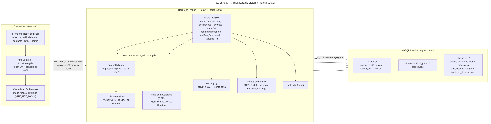

# PetConnect: Plataforma de Adoção Responsável de Animais

**Versão 1.0.0 (versão final, código congelado na tag `v1.0.0`)** · Fábrica de Software e Tópicos Avançados · 2026.2

📘 [Manual do Usuário](docs/MANUAL_USUARIO.md) · 🛠️ [Manual Técnico](docs/MANUAL_TECNICO.md) · 📚 [Índice da documentação](docs/README.md) · 📝 [Histórico de versões](CHANGELOG.md)

O PetConnect conecta cães e gatos resgatados por ONGs a adotantes compatíveis. O adotante preenche um formulário sobre a própria rotina, o sistema calcula a **compatibilidade** com cada animal usando um modelo de IA, e a ONG recebe os pedidos já com esse índice para decidir com mais segurança.

## Equipe

**Grupo [Nº]**

| Integrante | Papel |
|---|---|
| Kawan Marcus | Front-end, banco de dados e documentação |
| Ecliton Matheus | Back-end (API) |
| [Nome] | [Papel] |
| [Nome] | [Papel] |
| [Nome] | [Papel] |

## Objetivo da solução

Muitas adoções dão errado porque o animal não combina com a rotina da família (espaço, tempo sozinho, crianças, outros animais, nível de energia). O PetConnect:

- **ajuda o adotante** a encontrar animais compatíveis com o seu perfil;
- **dá à ONG** uma ferramenta para receber, analisar, aprovar ou recusar pedidos e acompanhar o pós-adoção;
- **dá ao administrador** o controle de ONGs e contas, com dashboard, relatórios e histórico de operações.

| Perfil | O que faz |
|---|---|
| Visitante | navega pelo catálogo, filtra animais e cria uma conta |
| Adotante | preenche o formulário, vê recomendações e compatibilidade, favorita, pede adoção e acompanha cada etapa |
| ONG | cadastra animais (com sugestão da IA pela foto), analisa pedidos, aprova, recusa, conclui e registra o pós-adoção; tem relatórios próprios |
| Administrador | aprova ONGs, gerencia contas e animais, acompanha dashboard, relatórios, pesquisa geral, logs e permissões |

## Tecnologias

| Camada | Tecnologias | Pasta |
|---|---|---|
| Interface | React 19, Vite 7, React Router 7, Axios | `src/`, `public/` |
| API | Python 3.11+, FastAPI, SQLAlchemy, PyMySQL, JWT (PyJWT), bcrypt | `backend/` |
| Inteligência artificial | scikit-learn (regressão logística) para a compatibilidade, OpenCL/NumPy para o cálculo em lote, MobileNetV2 + ONNX Runtime para a sugestão pela foto | `backend/app/ia/` |
| Banco de dados | MySQL 8 (funciona também no MariaDB do XAMPP) | `database/` |
| Testes | pytest (API) e Playwright (interface) | `backend/tests/`, `testes-e2e/` |



## Requisitos para executar

- **Node.js 20** ou mais novo (inclui o `npm`)
- **Python 3.11** ou mais novo
- **MySQL 8** com o **MySQL Workbench** (ou MariaDB/XAMPP)
- Git

## Instalação e configuração

### 1. Baixar o projeto
```bash
git clone https://github.com/Kawan-marcus/PetConnect.git
cd PetConnect
```

### 2. Banco de dados

No MySQL Workbench, conectado como `root`, abra e execute (botão ⚡) os scripts da pasta `database`, **nesta ordem**:

| Ordem | Script | O que faz |
|---|---|---|
| 1 | `01_schema.sql` | cria o banco `petconnect` e as 17 tabelas (apaga o banco se já existir) |
| 2 | `02_views.sql` | consultas prontas usadas pela API |
| 3 | `03_seed.sql` | dados iniciais: administrador, ONGs, adotantes e animais |
| 4 | `05_sprint06_modulo3.sql` | módulo de IA, tabela de logs e triggers de auditoria |
| 5 | `08_sprint07_relatorios.sql` | índices, views de relatório, pesquisa e mais logs |
| 6 | `09_dados_demonstracao.sql` | *(opcional)* seis meses de histórico para a apresentação |
| 7 | `10_sprint08_permissoes_regras.sql` | usuário só leitura, log imutável e regras de negócio no banco |
| 8 | `12_verificacao_final.sql` | *(opcional)* confere a estrutura; o esperado é "OK" em todas as linhas |

Depois, crie o usuário que a API usa (não use o `root` no sistema):
```sql
CREATE USER 'petconnect_app'@'localhost' IDENTIFIED BY 'troque_esta_senha';
GRANT SELECT, INSERT, UPDATE, DELETE ON petconnect.* TO 'petconnect_app'@'localhost';
```
Estrutura completa: [docs/BANCO_DE_DADOS.md](docs/BANCO_DE_DADOS.md).

### 3. Back-end (API)
```bash
cd backend
copy .env.example .env          # no Git Bash/Linux: cp .env.example .env
python -m venv venv
venv\Scripts\activate           # no Git Bash: source venv/Scripts/activate
pip install -r requirements.txt
python -m app.ia.baixar_modelo  # baixa o modelo de visão da sugestão pela foto (14 MB, uma vez)
```
Opcional, para o cálculo em paralelo na placa de vídeo: `pip install -r requirements-opencl.txt` (detalhes no [Manual Técnico](docs/MANUAL_TECNICO.md#63-back-end)).

Abra o `backend/.env` e preencha:

| Variável | Exemplo | Para quê |
|---|---|---|
| `DB_HOST` / `DB_PORT` | `localhost` / `3306` | onde está o MySQL |
| `DB_USER` / `DB_PASSWORD` | `petconnect_app` / sua senha | usuário criado no passo 2 |
| `DB_NAME` | `petconnect` | nome do banco |
| `JWT_SECRET` | texto aleatório com 32+ caracteres | assina os tokens de login |
| `APP_ENV` | `development` | em `production` o `JWT_SECRET` é obrigatório |
| `IA_MOTOR` | `auto` | `auto` usa OpenCL se houver, senão NumPy |

### 4. Front-end
Na **raiz** do projeto:
```bash
npm install
copy .env.example .env          # VITE_USE_MOCK=false (padrão): usa a API real
```

## Como executar

Abra dois terminais:

```bash
# Terminal 1 — API (dentro de backend/, com o venv ativado)
uvicorn app.main:app --reload --port 8000

# Terminal 2 — Front (na raiz)
npm run dev
```

- Sistema: **http://localhost:5173**
- Documentação interativa da API (Swagger): **http://localhost:8000/docs**
- Teste do banco: http://localhost:8000/api/health/db → `{"status": "conectado"}`

> O front usa a API real por padrão. Só com `VITE_USE_MOCK=true` ele funciona sozinho, com dados simulados no navegador (útil apenas para desenvolver telas; não use na apresentação).

### Contas de teste (senha `123456`)

| Perfil | E-mail |
|---|---|
| Administrador | admin@adotapet.com |
| ONG aprovada | ong@patinhas.org |
| ONG pendente | amigos4patas@email.com |
| Adotante | ana@email.com |

## Testes

```bash
# API: 106 casos (funcionais, validação, regras, permissões e IA pela foto) — dentro de backend/
pip install pytest httpx2                 # httpx2: cliente que os testes usam para chamar a API
python -m pytest tests -v                  # gera backend/tests/RELATORIO.md

# Interface: 25 casos (navegação, validação e fluxo completo) — com API e front ligados
npm install --no-save playwright
npx playwright install chromium
npm run teste:interface                    # gera testes-e2e/resultado/RELATORIO.md e prints
```

## Estrutura do projeto

```
PetConnect/
├── src/                     front-end React
│   ├── api/                 chamadas à API (e modo simulado em api/mock)
│   ├── components/          componentes reutilizáveis (layout, filtros, gráficos, tabelas)
│   ├── context/             sessão, avisos, favoritos e confirmações
│   ├── hooks/               formulários, tabelas, carregamento
│   ├── pages/               telas: publico/, adotante/, ong/, admin/
│   ├── routes/              rotas protegidas por perfil
│   ├── styles/              estilos globais
│   └── utils/               formatação, permissões, relatórios, exportação
├── public/                  arquivos estáticos (fotos de exemplo)
├── backend/
│   ├── app/
│   │   ├── main.py          criação da API, CORS e tratamento de erros
│   │   ├── routes/          rotas: auth, animais, ong, solicitações, admin, ia…
│   │   ├── ia/              compatibilidade, cálculo em lote (OpenCL) e sugestão pela foto
│   │   ├── security.py      JWT e conferência da conta a cada requisição
│   │   └── database.py      conexão com o MySQL
│   ├── tests/               testes automatizados da API (pytest)
│   └── requirements.txt
├── database/                scripts SQL (01 a 12) e diagramas MER/relacional
├── testes-e2e/              testes da interface (Playwright)
└── docs/                    API, banco, front, diagramas e documentação das Sprints
```

## Documentação

- [Manual do Usuário](docs/MANUAL_USUARIO.md) · [Manual Técnico](docs/MANUAL_TECNICO.md)
- [Requisitos, regras de negócio e casos de uso](docs/REQUISITOS_E_CASOS_DE_USO.md)
- [API — todas as rotas, parâmetros, autenticação e exemplos](docs/API.md) · [OpenAPI](docs/openapi.json) · [Contrato front ↔ back](docs/CONTRATO_API.md)
- [Banco de dados — dicionário de dados final](docs/BANCO_DE_DADOS.md) · [scripts](database/README.md)
- [Front-end](docs/FRONTEND.md)
- [Documentação de cada Sprint](docs/sprints/)
- [Apresentação e roteiro dos vídeos](docs/APRESENTACAO.md)
- Diagramas: [arquitetura](docs/diagramas/arquitetura.png) · [casos de uso](docs/diagramas/casos_de_uso.png) · [classes](docs/diagramas/diagrama_classes.png) · [MER](database/diagramas/mer_conceitual.png) · [relacional](database/diagramas/modelo_relacional.png)

## Problemas comuns

| Mensagem | Solução |
|---|---|
| `Access denied for user ...` | usuário ou senha errados no `backend/.env` |
| `Unknown database 'petconnect'` | rode os scripts do banco (passo 2) |
| A tela fica em "Carregando" | a API não está ligada na porta 8000 |
| "Sua sessão expirou" | entre de novo (acontece ao trocar o `JWT_SECRET`) |
| "A sugestão pela foto ainda não está ativa" | rode `python -m app.ia.baixar_modelo` dentro de `backend/` |

Mais situações no [Manual Técnico, seção 14](docs/MANUAL_TECNICO.md#14-solução-de-problemas).
