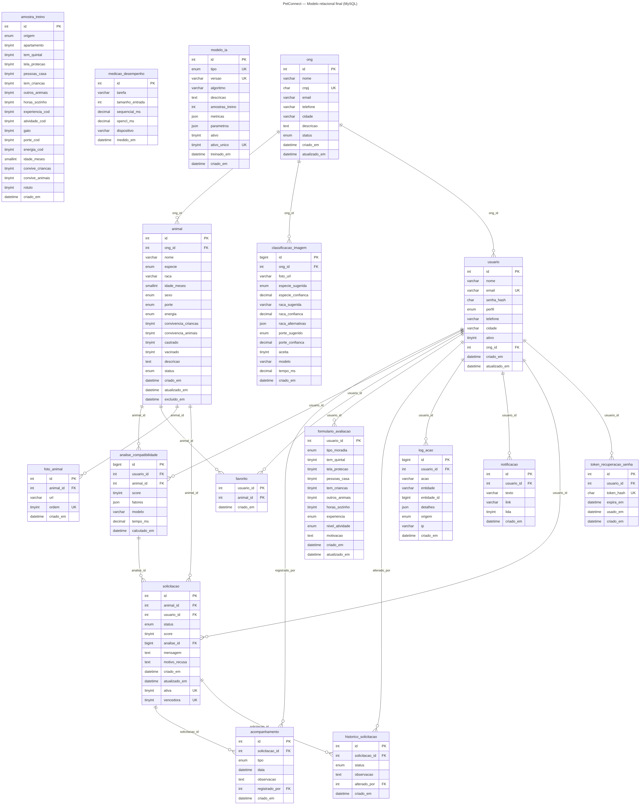

# Banco de dados — estrutura final (Release Candidate)

Gerado automaticamente a partir do banco `petconnect` (MySQL 8) depois de rodar os scripts 01 a 10.

**17 tabelas · 23 views · 19 chaves estrangeiras · 15 triggers · 6 procedures/funções**

## Ordem de instalação

| Script | Obrigatório | O que faz |
|---|---|---|
| `01_schema.sql` | sim | cria o banco e as tabelas (apaga o banco se já existir) |
| `02_views.sql` | sim | consultas prontas usadas pela API |
| `03_seed.sql` | sim | dados iniciais (admin, ONGs, adotantes, animais) |
| `05_sprint06_modulo3.sql` | sim | módulo de IA, logs (`log_acao`) e triggers de auditoria |
| `08_sprint07_relatorios.sql` | sim | índices, views de relatório, pesquisa e mais logs |
| `09_dados_demonstracao.sql` | não | 6 meses de histórico para apresentação |
| `10_sprint08_permissoes_regras.sql` | sim | usuário só leitura, log imutável e regras RN01–RN08 |
| `12_verificacao_final.sql` | não | confere estrutura e consistência (esperado: tudo OK) |

Os scripts `04`, `06`, `07` e `11` são consultas de teste e massa de dados das sprints anteriores.

## Tabelas

### `acompanhamento`

Visitas, contatos e fotos pós-adoção.

| Coluna | Tipo | Nulo | Chave | Padrão | Observação |
|---|---|---|---|---|---|
| `id` | `int unsigned` | não | PK | — | automático |
| `solicitacao_id` | `int unsigned` | não | FK → `solicitacao.id` (cascade) | — | — |
| `tipo` | `enum('visita','contato','foto')` | não | — | — | — |
| `data` | `datetime` | não | — | — | — |
| `observacao` | `text` | não | — | — | — |
| `registrado_por` | `int unsigned` | sim | FK → `usuario.id` (set null) | — | — |
| `criado_em` | `datetime` | não | — | CURRENT_TIMESTAMP | — |

Índices: `fk_acompanhamento_usuario`, `ix_acompanhamento_solicitacao`

### `amostra_treino`

Exemplos usados para treinar o modelo.

| Coluna | Tipo | Nulo | Chave | Padrão | Observação |
|---|---|---|---|---|---|
| `id` | `int unsigned` | não | PK | — | automático |
| `origem` | `enum('sintetico','importado')` | não | — | sintetico | — |
| `apartamento` | `tinyint unsigned` | não | — | — | — |
| `tem_quintal` | `tinyint unsigned` | não | — | — | — |
| `tela_protecao` | `tinyint unsigned` | não | — | — | — |
| `pessoas_casa` | `tinyint unsigned` | não | — | — | — |
| `tem_criancas` | `tinyint unsigned` | não | — | — | — |
| `outros_animais` | `tinyint unsigned` | não | — | — | — |
| `horas_sozinho` | `tinyint unsigned` | não | — | — | — |
| `experiencia_cod` | `tinyint unsigned` | não | — | — | — |
| `atividade_cod` | `tinyint unsigned` | não | — | — | — |
| `gato` | `tinyint unsigned` | não | — | — | — |
| `porte_cod` | `tinyint unsigned` | não | — | — | — |
| `energia_cod` | `tinyint unsigned` | não | — | — | — |
| `idade_meses` | `smallint unsigned` | não | — | — | — |
| `convive_criancas` | `tinyint unsigned` | não | — | — | — |
| `convive_animais` | `tinyint unsigned` | não | — | — | — |
| `rotulo` | `tinyint unsigned` | não | — | — | — |
| `criado_em` | `datetime` | não | — | CURRENT_TIMESTAMP | — |

Índices: `ix_amostra_origem`

### `analise_compatibilidade`

Cache do cálculo de compatibilidade (IA).

| Coluna | Tipo | Nulo | Chave | Padrão | Observação |
|---|---|---|---|---|---|
| `id` | `bigint unsigned` | não | PK | — | automático |
| `usuario_id` | `int unsigned` | não | FK → `usuario.id` (cascade) | — | — |
| `animal_id` | `int unsigned` | não | FK → `animal.id` (cascade) | — | — |
| `score` | `tinyint unsigned` | não | — | — | — |
| `fatores` | `json` | não | — | — | — |
| `modelo` | `varchar(40)` | não | — | — | — |
| `tempo_ms` | `decimal(10,3)` | sim | — | — | — |
| `calculado_em` | `datetime` | não | — | CURRENT_TIMESTAMP | — |

Índices: `fk_analise_animal`, `ix_analise_animal`, `ix_analise_modelo`, `ix_analise_par`

### `animal`

Animais para adoção (exclusão lógica em excluido_em).

| Coluna | Tipo | Nulo | Chave | Padrão | Observação |
|---|---|---|---|---|---|
| `id` | `int unsigned` | não | PK | — | automático |
| `ong_id` | `int unsigned` | não | FK → `ong.id` (no action) | — | — |
| `nome` | `varchar(80)` | não | — | — | — |
| `especie` | `enum('cao','gato')` | não | — | — | — |
| `raca` | `varchar(80)` | não | — | SRD | — |
| `idade_meses` | `smallint unsigned` | não | — | — | — |
| `sexo` | `enum('M','F')` | não | — | — | — |
| `porte` | `enum('pequeno','medio','grande')` | não | — | — | — |
| `energia` | `enum('baixa','media','alta')` | não | — | — | — |
| `convivencia_criancas` | `tinyint(1)` | não | — | — | — |
| `convivencia_animais` | `tinyint(1)` | não | — | — | — |
| `castrado` | `tinyint(1)` | não | — | — | — |
| `vacinado` | `tinyint(1)` | não | — | — | — |
| `descricao` | `text` | não | — | — | — |
| `status` | `enum('disponivel','em_processo','adotado')` | não | — | disponivel | — |
| `criado_em` | `datetime` | não | — | CURRENT_TIMESTAMP | — |
| `atualizado_em` | `datetime` | não | — | CURRENT_TIMESTAMP | on update CURRENT_TIMESTAMP |
| `excluido_em` | `datetime` | sim | — | — | — |

Índices: `ft_animal_texto`, `ix_animal_busca`, `ix_animal_criado`, `ix_animal_nome`, `ix_animal_ong`, `ix_animal_publico`

### `classificacao_imagem`

Sugestões da IA a partir da foto do animal.

| Coluna | Tipo | Nulo | Chave | Padrão | Observação |
|---|---|---|---|---|---|
| `id` | `bigint unsigned` | não | PK | — | automático |
| `ong_id` | `int unsigned` | não | FK → `ong.id` (no action) | — | — |
| `foto_url` | `varchar(500)` | não | — | — | — |
| `especie_sugerida` | `enum('cao','gato')` | não | — | — | — |
| `especie_confianca` | `decimal(4,3)` | não | — | — | — |
| `raca_sugerida` | `varchar(80)` | não | — | — | — |
| `raca_confianca` | `decimal(4,3)` | não | — | — | — |
| `raca_alternativas` | `json` | sim | — | — | — |
| `porte_sugerido` | `enum('pequeno','medio','grande')` | não | — | — | — |
| `porte_confianca` | `decimal(4,3)` | não | — | — | — |
| `aceita` | `tinyint(1)` | sim | — | — | — |
| `modelo` | `varchar(40)` | não | — | — | — |
| `tempo_ms` | `decimal(10,3)` | sim | — | — | — |
| `criado_em` | `datetime` | não | — | CURRENT_TIMESTAMP | — |

Índices: `ix_classificacao_ong`

### `favorito`

Animais favoritados pelos adotantes.

| Coluna | Tipo | Nulo | Chave | Padrão | Observação |
|---|---|---|---|---|---|
| `usuario_id` | `int unsigned` | não | PK · FK → `usuario.id` (cascade) | — | — |
| `animal_id` | `int unsigned` | não | PK · FK → `animal.id` (cascade) | — | — |
| `criado_em` | `datetime` | não | — | CURRENT_TIMESTAMP | — |

Índices: `ix_favorito_animal`

### `formulario_avaliacao`

Formulário de avaliação do adotante (um por adotante).

| Coluna | Tipo | Nulo | Chave | Padrão | Observação |
|---|---|---|---|---|---|
| `usuario_id` | `int unsigned` | não | PK · FK → `usuario.id` (cascade) | — | — |
| `tipo_moradia` | `enum('casa','apartamento')` | não | — | — | — |
| `tem_quintal` | `tinyint(1)` | não | — | — | — |
| `tela_protecao` | `tinyint(1)` | não | — | — | — |
| `pessoas_casa` | `tinyint unsigned` | não | — | — | — |
| `tem_criancas` | `tinyint(1)` | não | — | — | — |
| `outros_animais` | `tinyint(1)` | não | — | — | — |
| `horas_sozinho` | `tinyint unsigned` | não | — | — | — |
| `experiencia` | `enum('nenhuma','alguma','muita')` | não | — | — | — |
| `nivel_atividade` | `enum('baixo','medio','alto')` | não | — | — | — |
| `motivacao` | `text` | não | — | — | — |
| `criado_em` | `datetime` | não | — | CURRENT_TIMESTAMP | — |
| `atualizado_em` | `datetime` | não | — | CURRENT_TIMESTAMP | on update CURRENT_TIMESTAMP |

### `foto_animal`

Fotos de cada animal, em ordem.

| Coluna | Tipo | Nulo | Chave | Padrão | Observação |
|---|---|---|---|---|---|
| `id` | `int unsigned` | não | PK | — | automático |
| `animal_id` | `int unsigned` | não | UK · FK → `animal.id` (cascade) | — | — |
| `url` | `varchar(500)` | não | — | — | — |
| `ordem` | `tinyint unsigned` | não | UK | 0 | — |
| `criado_em` | `datetime` | não | — | CURRENT_TIMESTAMP | — |

Índices: `uq_foto_ordem`

### `historico_solicitacao`

Cada etapa de cada pedido (linha do tempo).

| Coluna | Tipo | Nulo | Chave | Padrão | Observação |
|---|---|---|---|---|---|
| `id` | `int unsigned` | não | PK | — | automático |
| `solicitacao_id` | `int unsigned` | não | FK → `solicitacao.id` (cascade) | — | — |
| `status` | `enum('pendente','em_analise','aprovada','recusada','concluida','encerrada','cancelada')` | não | — | — | — |
| `observacao` | `text` | sim | — | — | — |
| `alterado_por` | `int unsigned` | sim | FK → `usuario.id` (set null) | — | — |
| `criado_em` | `datetime` | não | — | CURRENT_TIMESTAMP | — |

Índices: `fk_historico_usuario`, `ix_historico_solicitacao`, `ix_historico_status_data`

### `log_acao`

Histórico de operações (auditoria), imutável.

| Coluna | Tipo | Nulo | Chave | Padrão | Observação |
|---|---|---|---|---|---|
| `id` | `bigint unsigned` | não | PK | — | automático |
| `usuario_id` | `int unsigned` | sim | FK → `usuario.id` (set null) | — | — |
| `acao` | `varchar(60)` | não | — | — | — |
| `entidade` | `varchar(40)` | não | — | — | — |
| `entidade_id` | `bigint unsigned` | sim | — | — | — |
| `detalhes` | `json` | sim | — | — | — |
| `origem` | `enum('trigger','backend')` | não | — | backend | — |
| `ip` | `varchar(45)` | sim | — | — | — |
| `criado_em` | `datetime` | não | — | CURRENT_TIMESTAMP | — |

Índices: `ix_log_acao`, `ix_log_data`, `ix_log_entidade`, `ix_log_usuario`

### `medicao_desempenho`

Medições sequencial × OpenCL.

| Coluna | Tipo | Nulo | Chave | Padrão | Observação |
|---|---|---|---|---|---|
| `id` | `int unsigned` | não | PK | — | automático |
| `tarefa` | `varchar(160)` | não | — | — | — |
| `tamanho_entrada` | `int unsigned` | não | — | — | — |
| `sequencial_ms` | `decimal(12,3)` | não | — | — | — |
| `opencl_ms` | `decimal(12,3)` | não | — | — | — |
| `dispositivo` | `varchar(160)` | não | — | — | — |
| `medido_em` | `datetime` | não | — | CURRENT_TIMESTAMP | — |

Índices: `ix_medicao_tarefa`

### `modelo_ia`

Versões do modelo de compatibilidade treinado.

| Coluna | Tipo | Nulo | Chave | Padrão | Observação |
|---|---|---|---|---|---|
| `id` | `int unsigned` | não | PK | — | automático |
| `tipo` | `enum('compatibilidade','visao')` | não | UK | — | — |
| `versao` | `varchar(40)` | não | UK | — | — |
| `algoritmo` | `varchar(120)` | não | — | — | — |
| `descricao` | `text` | sim | — | — | — |
| `amostras_treino` | `int unsigned` | sim | — | — | — |
| `metricas` | `json` | sim | — | — | — |
| `parametros` | `json` | sim | — | — | — |
| `ativo` | `tinyint(1)` | não | — | 0 | — |
| `ativo_unico` | `tinyint` | sim | UK | — | STORED GENERATED |
| `treinado_em` | `datetime` | sim | — | — | — |
| `criado_em` | `datetime` | não | — | CURRENT_TIMESTAMP | — |

Índices: `uq_modelo_ativo_por_tipo`, `uq_modelo_versao`

### `notificacao`

Avisos exibidos no sino do usuário.

| Coluna | Tipo | Nulo | Chave | Padrão | Observação |
|---|---|---|---|---|---|
| `id` | `int unsigned` | não | PK | — | automático |
| `usuario_id` | `int unsigned` | não | FK → `usuario.id` (cascade) | — | — |
| `texto` | `varchar(255)` | não | — | — | — |
| `link` | `varchar(255)` | sim | — | — | — |
| `lida` | `tinyint(1)` | não | — | 0 | — |
| `criado_em` | `datetime` | não | — | CURRENT_TIMESTAMP | — |

Índices: `ix_notificacao_usuario`

### `ong`

ONGs cadastradas; só as aprovadas publicam animais.

| Coluna | Tipo | Nulo | Chave | Padrão | Observação |
|---|---|---|---|---|---|
| `id` | `int unsigned` | não | PK | — | automático |
| `nome` | `varchar(120)` | não | — | — | — |
| `cnpj` | `char(18)` | não | UK | — | — |
| `email` | `varchar(160)` | não | — | — | — |
| `telefone` | `varchar(20)` | não | — | — | — |
| `cidade` | `varchar(100)` | não | — | — | — |
| `descricao` | `text` | sim | — | — | — |
| `status` | `enum('pendente','aprovada','suspensa')` | não | — | pendente | — |
| `criado_em` | `datetime` | não | — | CURRENT_TIMESTAMP | — |
| `atualizado_em` | `datetime` | não | — | CURRENT_TIMESTAMP | on update CURRENT_TIMESTAMP |

Índices: `ix_ong_nome`, `ix_ong_status`, `uq_ong_cnpj`

### `solicitacao`

Pedidos de adoção, com status e score de compatibilidade.

| Coluna | Tipo | Nulo | Chave | Padrão | Observação |
|---|---|---|---|---|---|
| `id` | `int unsigned` | não | PK | — | automático |
| `animal_id` | `int unsigned` | não | UK · FK → `animal.id` (no action) | — | — |
| `usuario_id` | `int unsigned` | não | UK · FK → `usuario.id` (no action) | — | — |
| `status` | `enum('pendente','em_analise','aprovada','recusada','concluida','encerrada','cancelada')` | não | — | pendente | — |
| `score` | `tinyint unsigned` | sim | — | — | — |
| `analise_id` | `bigint unsigned` | sim | FK → `analise_compatibilidade.id` (set null) | — | — |
| `mensagem` | `text` | sim | — | — | — |
| `motivo_recusa` | `text` | sim | — | — | — |
| `criado_em` | `datetime` | não | — | CURRENT_TIMESTAMP | — |
| `atualizado_em` | `datetime` | não | — | CURRENT_TIMESTAMP | on update CURRENT_TIMESTAMP |
| `ativa` | `tinyint` | sim | UK | — | STORED GENERATED |
| `vencedora` | `tinyint` | sim | UK | — | STORED GENERATED |

Índices: `fk_solicitacao_analise`, `ix_solicitacao_animal_status`, `ix_solicitacao_criado`, `ix_solicitacao_status`, `uq_solicitacao_ativa_rn05`, `uq_solicitacao_vencedora_rn02`

### `token_recuperacao_senha`

Códigos temporários para redefinir senha.

| Coluna | Tipo | Nulo | Chave | Padrão | Observação |
|---|---|---|---|---|---|
| `id` | `int unsigned` | não | PK | — | automático |
| `usuario_id` | `int unsigned` | não | FK → `usuario.id` (cascade) | — | — |
| `token_hash` | `char(64)` | não | UK | — | — |
| `expira_em` | `datetime` | não | — | — | — |
| `usado_em` | `datetime` | sim | — | — | — |
| `criado_em` | `datetime` | não | — | CURRENT_TIMESTAMP | — |

Índices: `fk_token_usuario`, `uq_token_hash`

### `usuario`

Contas de acesso (adotante, ONG e administrador).

| Coluna | Tipo | Nulo | Chave | Padrão | Observação |
|---|---|---|---|---|---|
| `id` | `int unsigned` | não | PK | — | automático |
| `nome` | `varchar(120)` | não | — | — | — |
| `email` | `varchar(160)` | não | UK | — | — |
| `senha_hash` | `char(60)` | não | — | — | — |
| `perfil` | `enum('adotante','ong','admin')` | não | — | adotante | — |
| `telefone` | `varchar(20)` | sim | — | — | — |
| `cidade` | `varchar(100)` | sim | — | — | — |
| `ativo` | `tinyint(1)` | não | — | 1 | — |
| `ong_id` | `int unsigned` | sim | FK → `ong.id` (no action) | — | — |
| `criado_em` | `datetime` | não | — | CURRENT_TIMESTAMP | — |
| `atualizado_em` | `datetime` | não | — | CURRENT_TIMESTAMP | on update CURRENT_TIMESTAMP |

Índices: `fk_usuario_ong`, `ix_usuario_criado`, `ix_usuario_nome`, `ix_usuario_perfil`, `uq_usuario_email`

## Relacionamentos

| Tabela | Coluna | Referencia | Ao apagar |
|---|---|---|---|
| `acompanhamento` | `solicitacao_id` | `solicitacao.id` | cascade |
| `acompanhamento` | `registrado_por` | `usuario.id` | set null |
| `analise_compatibilidade` | `animal_id` | `animal.id` | cascade |
| `analise_compatibilidade` | `usuario_id` | `usuario.id` | cascade |
| `animal` | `ong_id` | `ong.id` | no action |
| `classificacao_imagem` | `ong_id` | `ong.id` | no action |
| `favorito` | `animal_id` | `animal.id` | cascade |
| `favorito` | `usuario_id` | `usuario.id` | cascade |
| `formulario_avaliacao` | `usuario_id` | `usuario.id` | cascade |
| `foto_animal` | `animal_id` | `animal.id` | cascade |
| `historico_solicitacao` | `solicitacao_id` | `solicitacao.id` | cascade |
| `historico_solicitacao` | `alterado_por` | `usuario.id` | set null |
| `log_acao` | `usuario_id` | `usuario.id` | set null |
| `notificacao` | `usuario_id` | `usuario.id` | cascade |
| `solicitacao` | `analise_id` | `analise_compatibilidade.id` | set null |
| `solicitacao` | `animal_id` | `animal.id` | no action |
| `solicitacao` | `usuario_id` | `usuario.id` | no action |
| `token_recuperacao_senha` | `usuario_id` | `usuario.id` | cascade |
| `usuario` | `ong_id` | `ong.id` | no action |

## Views

`vw_adocao_concluida`, `vw_adocoes_por_mes`, `vw_adocoes_por_ong`, `vw_animal_publico`, `vw_dataset_treino`, `vw_desempenho_resumo`, `vw_eficacia_ia`, `vw_estatisticas_totais`, `vw_features_adotante`, `vw_features_animal`, `vw_integracao_adocao`, `vw_log_detalhado`, `vw_log_resumo_diario`, `vw_matriz_permissoes`, `vw_ranking_compatibilidade`, `vw_rel_adocoes`, `vw_rel_animais_espera`, `vw_rel_cadastros_mes`, `vw_rel_compatibilidade`, `vw_rel_desempenho_ong`, `vw_rel_solicitacoes`, `vw_solicitacao_detalhe`, `vw_ultima_analise`

## Triggers

| Trigger | Quando | Tabela |
|---|---|---|
| `trg_log_acompanhamento` | AFTER INSERT | `acompanhamento` |
| `trg_log_animal_alteracao` | AFTER UPDATE | `animal` |
| `trg_log_animal_cadastro` | AFTER INSERT | `animal` |
| `trg_rn_animal_alteracao` | BEFORE UPDATE | `animal` |
| `trg_rn_animal_novo` | BEFORE INSERT | `animal` |
| `trg_log_formulario_alterado` | AFTER UPDATE | `formulario_avaliacao` |
| `trg_log_formulario_novo` | AFTER INSERT | `formulario_avaliacao` |
| `trg_log_historico_solicitacao` | AFTER INSERT | `historico_solicitacao` |
| `trg_log_imutavel_delete` | BEFORE DELETE | `log_acao` |
| `trg_log_imutavel_update` | BEFORE UPDATE | `log_acao` |
| `trg_log_ong_status` | AFTER UPDATE | `ong` |
| `trg_rn_solicitacao_fluxo` | BEFORE UPDATE | `solicitacao` |
| `trg_rn_solicitacao_nova` | BEFORE INSERT | `solicitacao` |
| `trg_log_usuario_ativo` | AFTER UPDATE | `usuario` |
| `trg_log_usuario_cadastro` | AFTER INSERT | `usuario` |

## Procedures e funções

| Nome | Tipo |
|---|---|
| `sp_gerar_historico_demo` | procedure |
| `sp_gerar_massa_dados` | procedure |
| `sp_limpar_historico_demo` | procedure |
| `sp_limpar_massa_dados` | procedure |
| `sp_pesquisar` | procedure |
| `sp_relatorio_periodo` | procedure |
