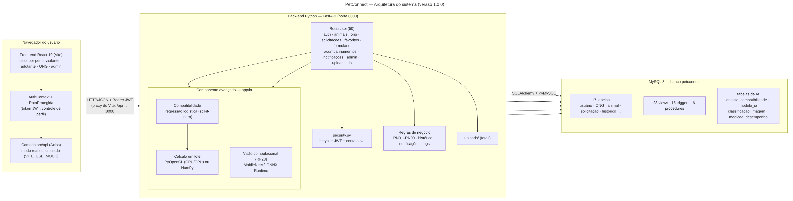
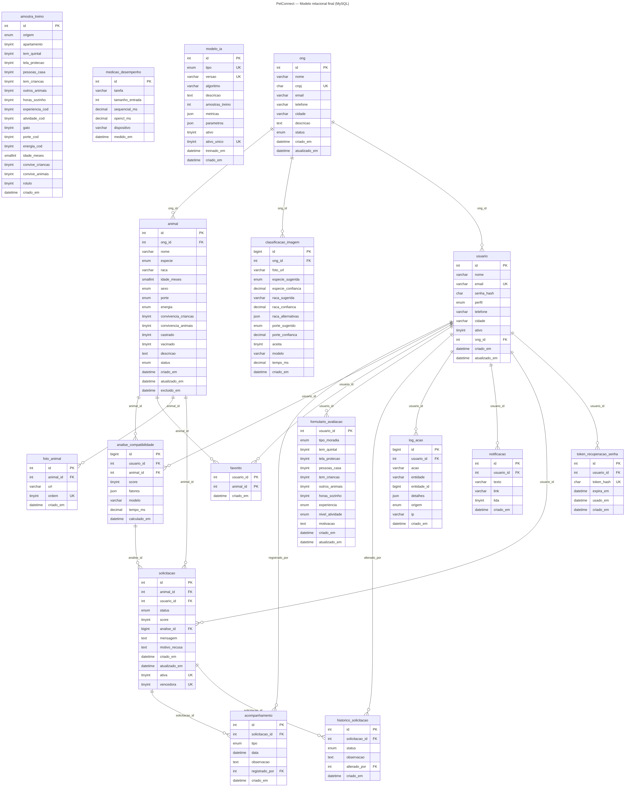

# PetConnect — Manual Técnico

**Versão 1.0.0** · Fábrica de Software e Tópicos Avançados · 2026.2
Repositório: [github.com/Kawan-marcus/PetConnect](https://github.com/Kawan-marcus/PetConnect)

Este manual é para quem vai instalar, executar, manter ou continuar o desenvolvimento do PetConnect. Para o uso das telas, veja o [Manual do Usuário](MANUAL_USUARIO.md).

## Sumário

1. [Visão geral da arquitetura](#1-visão-geral-da-arquitetura)
2. [Tecnologias, linguagens e bibliotecas](#2-tecnologias-linguagens-e-bibliotecas)
3. [Organização dos módulos e componentes](#3-organização-dos-módulos-e-componentes)
4. [Banco de dados](#4-banco-de-dados)
5. [Requisitos de ambiente](#5-requisitos-de-ambiente)
6. [Instalação e configuração](#6-instalação-e-configuração)
7. [Variáveis de ambiente](#7-variáveis-de-ambiente)
8. [Execução](#8-execução)
9. [API](#9-api)
10. [Componente de IA e processamento paralelo](#10-componente-de-ia-e-processamento-paralelo)
11. [Segurança](#11-segurança)
12. [Testes](#12-testes)
13. [Manutenção e continuidade](#13-manutenção-e-continuidade)
14. [Solução de problemas](#14-solução-de-problemas)

---

## 1. Visão geral da arquitetura

O sistema tem três camadas que conversam por HTTP/JSON e SQL:

| Camada | Responsabilidade | Onde roda |
|---|---|---|
| **Front-end** (React) | telas por perfil, validação dos formulários, controle de rotas por perfil | navegador do usuário (servido pelo Vite na porta 5173) |
| **Back-end** (FastAPI) | regras de negócio, autenticação, permissões, IA, uploads e logs | servidor Python (porta 8000) |
| **Banco** (MySQL 8) | dados, integridade (chaves, `CHECK`, índices únicos), triggers de auditoria e regras críticas | servidor MySQL (porta 3306) |



Fluxo de uma requisição: a tela chama uma função de `src/api/*.js` → o Axios envia para `/api/...` com o token JWT no cabeçalho → o proxy do Vite repassa para a porta 8000 → a rota FastAPI confere o token e o perfil, aplica as regras e consulta o MySQL pelo SQLAlchemy → a resposta volta em JSON. Erros sempre voltam como `{"detail": "mensagem"}`, que o front mostra ao usuário.

As regras mais importantes ficam **em duas camadas** (API e banco). Por exemplo, "uma solicitação ativa por usuário e animal" é conferida na API e garantida por um índice único no MySQL; assim nem uma chamada direta ao banco quebra a regra.

## 2. Tecnologias, linguagens e bibliotecas

| Camada | Linguagem | Bibliotecas principais | Versão |
|---|---|---|---|
| Front-end | JavaScript (JSX), CSS | React, React Router, Axios, Vite | React 19, Router 7, Vite 7 |
| Back-end | Python 3.11+ | FastAPI, Uvicorn, SQLAlchemy 2, PyMySQL, PyJWT, bcrypt, python-dotenv, python-multipart | ver `backend/requirements.txt` |
| IA — compatibilidade | Python | scikit-learn (regressão logística), NumPy | scikit-learn 1.8, NumPy 2.4 |
| IA — processamento paralelo | Python + OpenCL C | PyOpenCL (opcional) | OpenCL 1.2+ |
| IA — visão computacional | Python | ONNX Runtime, Pillow, modelo MobileNetV2 (ImageNet) | ONNX Runtime 1.29 |
| Banco | SQL | MySQL 8 (ou MariaDB 10.6+) | — |
| Testes | Python / JavaScript | pytest + httpx2 (API), Playwright (interface) | — |
| Diagramas | Mermaid | `.mmd` em `docs/diagramas` e `database/diagramas` | — |

## 3. Organização dos módulos e componentes

```
PetConnect/
├── src/                         front-end React
│   ├── api/                     uma função por rota da API (client.js = Axios + token + erros)
│   │   └── mock/                modo demonstração (dados simulados, opcional)
│   ├── components/              Layout, filtros, cartões, gráficos, tabelas, modal, trilha
│   ├── context/                 AuthContext (sessão), Toast, Favoritos, Confirmar
│   ├── hooks/                   useFormulario (validações), useTabela, useAsync
│   ├── pages/publico|adotante|ong|admin/   uma tela por arquivo
│   ├── routes/                  RotaProtegida (perfil) e mapaRotas (trilha e títulos)
│   └── utils/                   permissões, relatórios, exportação CSV/PDF, formatação
├── backend/
│   ├── app/
│   │   ├── main.py              cria a API, registra as rotas, serve /uploads, erros do banco (1644 → 409)
│   │   ├── database.py          conexão (lê o .env) e limpeza da variável de log por conexão
│   │   ├── security.py          bcrypt, geração e conferência do JWT, conta ativa
│   │   ├── logs.py              log no terminal + usuário logado para os triggers de auditoria
│   │   ├── paginacao.py         parâmetros limit/offset opcionais
│   │   ├── documentacao.py      textos em português do Swagger
│   │   ├── routes/              auth, animais, ong, solicitacoes, favoritos, formulario,
│   │   │                        acompanhamentos, notificacoes, admin, uploads, ia, recuperacao
│   │   └── ia/                  componente avançado (seção 10)
│   ├── tests/                   106 testes da API (pytest) + fotos de teste
│   └── uploads/                 fotos enviadas (fora do Git)
├── database/                    scripts SQL 01 a 12 e diagramas (MER e relacional)
├── testes-e2e/                  25 testes da interface (Playwright)
└── docs/                        manuais, API, banco, front, diagramas e Sprints
```

**Responsabilidade das rotas do back-end:**

| Arquivo | Prefixo | O que faz |
|---|---|---|
| `auth.py` | `/api/auth` | login, cadastro de adotante e ONG (CNPJ validado), perfil |
| `recuperacao.py` | `/api/auth` | recuperar e redefinir senha por link com token de 1 hora |
| `animais.py` | `/api/animais` | catálogo público com filtros, detalhe, edição e exclusão pela ONG dona |
| `ong.py` | `/api/ong` | animais, solicitações, adoções e indicadores da ONG; `verificar_ong()` |
| `solicitacoes.py` | `/api/solicitacoes` | pedir, cancelar, analisar, aprovar, recusar e concluir (RN01–RN09) |
| `formulario.py` | `/api/formulario` | formulário de avaliação do adotante |
| `favoritos.py` | `/api/favoritos` | favoritar e listar |
| `acompanhamentos.py` | `/api` | pós-adoção (`/api/ong/adocoes`, `/api/solicitacoes/{id}/acompanhamentos`) |
| `notificacoes.py` | `/api/notificacoes` | listar e marcar como lidas |
| `admin.py` | `/api/admin` | usuários, ONGs, animais, estatísticas, pesquisa, logs, desempenho |
| `uploads.py` | `/api/uploads` | envio de fotos (só ONG aprovada) |
| `ia.py` | `/api/ia` | compatibilidade, recomendações, modelo e classificação por foto |

## 4. Banco de dados

**17 tabelas · 23 views · 19 chaves estrangeiras · 15 triggers · 6 procedures/funções.** O dicionário completo (cada coluna, tipo e regra) está em [BANCO_DE_DADOS.md](BANCO_DE_DADOS.md).

| Grupo | Tabelas |
|---|---|
| Pessoas e instituições | `usuario`, `ong`, `token_recuperacao_senha` |
| Animais | `animal`, `foto_animal`, `favorito` |
| Adoção | `formulario_avaliacao`, `solicitacao`, `historico_solicitacao`, `acompanhamento`, `notificacao` |
| IA | `analise_compatibilidade`, `modelo_ia`, `amostra_treino`, `classificacao_imagem`, `medicao_desempenho` |
| Auditoria | `log_acao` (somente inserção: triggers bloqueiam UPDATE e DELETE) |



**Scripts** (pasta `database/`, executar nesta ordem):

| Script | Obrigatório | O que faz |
|---|---|---|
| `01_schema.sql` | sim | cria o banco `petconnect` e as tabelas (apaga o banco se existir) |
| `02_views.sql` | sim | views usadas pela API |
| `03_seed.sql` | sim | administrador, ONGs, adotantes e animais de exemplo |
| `05_sprint06_modulo3.sql` | sim | tabelas da IA, `log_acao` e triggers de auditoria |
| `08_sprint07_relatorios.sql` | sim | índices, views de relatório e pesquisa |
| `09_dados_demonstracao.sql` | não | seis meses de histórico para o dashboard |
| `10_sprint08_permissoes_regras.sql` | sim | usuário só leitura, log imutável, máquina de estados da solicitação |
| `12_verificacao_final.sql` | não | 14 verificações de consistência (todas devem dar "OK") |

Os scripts `04`, `06`, `07` e `11` são consultas de apoio e geração de massa de dados para o benchmark; não alteram a estrutura.

## 5. Requisitos de ambiente

| Item | Versão mínima | Observação |
|---|---|---|
| Sistema operacional | Windows 10, Linux ou macOS | testado em Windows 11 e Linux |
| Node.js | 20 | inclui o `npm` |
| Python | 3.11 | testado no 3.13 |
| MySQL | 8.0 | ou MariaDB 10.6+ (XAMPP) |
| MySQL Workbench | 8.0 | para rodar os scripts |
| Git | 2.x | — |
| Placa de vídeo com OpenCL | opcional | sem ela o cálculo em lote usa NumPy (mesmo resultado) |
| Internet | só na instalação | `npm install`, `pip install` e download do modelo de visão (14 MB) |

## 6. Instalação e configuração

### 6.1 Código
```bash
git clone https://github.com/Kawan-marcus/PetConnect.git
cd PetConnect
```

### 6.2 Banco de dados
1. Abra o MySQL Workbench e conecte como `root`.
2. Abra (File → Open SQL Script) e execute (⚡) os scripts da tabela da seção 4, na ordem.
3. Crie o usuário da aplicação (nunca use o `root` no sistema):
```sql
CREATE USER 'petconnect_app'@'localhost' IDENTIFIED BY 'escolha_uma_senha';
GRANT SELECT, INSERT, UPDATE, DELETE ON petconnect.* TO 'petconnect_app'@'localhost';
```
> No Workbench, se aparecer o erro 1175 (safe update mode), o script 09 já desliga essa proteção só durante a execução.

### 6.3 Back-end
```bash
cd backend
python -m venv venv
venv\Scripts\activate                 # Git Bash: source venv/Scripts/activate · Linux: source venv/bin/activate
pip install -r requirements.txt
copy .env.example .env                # Git Bash/Linux: cp .env.example .env
python -m app.ia.baixar_modelo        # baixa o modelo de visão (uma vez)
```
Preencha o `backend/.env` (seção 7).

**OpenCL (opcional):** `pip install -r requirements-opencl.txt`. No Windows, o driver da placa de vídeo (Intel, NVIDIA ou AMD) já traz o OpenCL; confira com `python -c "import pyopencl as cl; print(cl.get_platforms())"`. No Linux ou macOS sem driver, `pip install "pyopencl[pocl]"` instala o PoCL, que executa os mesmos kernels na CPU. Sem OpenCL a API funciona normalmente com NumPy, mas o benchmark não grava medição (não há execução paralela real para medir).

### 6.4 Front-end
Na raiz do projeto:
```bash
npm install
copy .env.example .env                # Git Bash/Linux: cp .env.example .env
```

## 7. Variáveis de ambiente

Os arquivos `.env` **não vão para o GitHub** (estão no `.gitignore`). O repositório traz apenas os modelos `.env.example`, sem senhas reais.

**`backend/.env`**

| Variável | Exemplo | Para quê |
|---|---|---|
| `DB_HOST` / `DB_PORT` | `localhost` / `3306` | endereço do MySQL |
| `DB_USER` / `DB_PASSWORD` | `petconnect_app` / *(sua senha)* | usuário criado no passo 6.2 |
| `DB_NAME` | `petconnect` | nome do banco |
| `JWT_SECRET` | texto aleatório com 32+ caracteres | assina os tokens de login; trocar invalida as sessões |
| `APP_ENV` | `development` ou `production` | em `production` a API não sobe sem `JWT_SECRET` |
| `IA_MOTOR` | `auto` | `auto` usa OpenCL se houver, senão NumPy · `opencl` exige · `numpy` nunca usa |
| `IA_MODELO_VISAO` | *(opcional)* | outro caminho para o arquivo `.onnx` do modelo de visão |

**`.env` da raiz (front-end)**

| Variável | Padrão | Para quê |
|---|---|---|
| `VITE_USE_MOCK` | `false` | `true` liga o modo demonstração (dados simulados no navegador, sem API) |
| `VITE_API_URL` | `/api` | endereço base da API (o proxy do Vite leva para a porta 8000) |
| `VITE_HASH_ROUTER` | `false` | `true` usa endereços `/#/rota` (hospedagem sem redirecionamento) |

## 8. Execução

Dois terminais:
```bash
# Terminal 1 — API (pasta backend, venv ativo)
uvicorn app.main:app --reload --port 8000

# Terminal 2 — Front (raiz)
npm run dev
```

| Endereço | O quê |
|---|---|
| http://localhost:5173 | sistema |
| http://localhost:8000/docs | Swagger (documentação interativa da API) |
| http://localhost:8000/api/health/db | teste do banco → `{"status": "conectado"}` |
| http://localhost:8000/api/ia/modelo | modelo de IA em uso e motor (OpenCL ou NumPy) |

**Build de produção do front:** `npm run build` gera a pasta `dist/`, que pode ser servida por qualquer servidor web, desde que `/api` seja encaminhado para a API.

## 9. API

API REST com **50 rotas**, JSON em UTF-8 e autenticação por **Bearer JWT**.

- Referência completa (método, perfil, parâmetros e exemplo de resposta de cada rota): [API.md](API.md)
- Especificação OpenAPI (importável no Postman/Insomnia): [openapi.json](openapi.json)
- Swagger com resumos em português: http://localhost:8000/docs

| Código | Significado |
|---|---|
| 200 / 201 | sucesso |
| 400 | dado inválido (ex.: CNPJ, foto grande) |
| 401 | sem login, token inválido/expirado ou conta desativada |
| 403 | perfil sem permissão (ex.: adotante em rota de ONG) ou ONG não aprovada |
| 404 | recurso não encontrado (ou de outra ONG) |
| 409 | regra de negócio (ex.: pedido duplicado, animal adotado); também erros 1644 levantados pelos triggers do banco |
| 422 | formato inválido ou foto sem cão/gato |
| 503 | modelo de visão não instalado |

Paginação opcional nas listas: `?limit=20&offset=0`.

## 10. Componente de IA e processamento paralelo

O componente avançado (integração com Tópicos Avançados) fica em `backend/app/ia/` e tem três partes.

### 10.1 Compatibilidade adotante × animal (RF20, RF21, RF22)

| Arquivo | Papel |
|---|---|
| `codificacao.py` | transforma o formulário do adotante (9 números) e o animal (6 números) em vetores |
| `fatores.py` | calcula os 6 fatores (espaço, energia, tempo sozinho, crianças, outros animais, experiência), em Python e em NumPy |
| `treinar.py` | treina a **regressão logística** (scikit-learn) com 16.000 casos simulados por critérios de ONGs + casos reais do banco (`vw_dataset_treino`) |
| `modelo.py` | carrega `modelo_compatibilidade.json` (pesos, intercepto, métricas) e explica a contribuição de cada fator |
| `servico.py` | usado pelas rotas: `avaliar` (1 par), `recomendar` (lote), `salvar_analise` (grava em `analise_compatibilidade`) |

Métricas do modelo atual (`compat-logreg-v1`, 4.000 casos de teste): acurácia 76,8% · precisão 78,7% · recall 83,1% · F1 0,81 · **AUC 0,84**. O score exibido é a probabilidade de a adoção dar certo × 100.

Retreinar: `python -m app.ia.treinar --registrar` (salva o JSON e registra a versão em `modelo_ia`).

### 10.2 Processamento paralelo com OpenCL

`opencl.py` contém o **kernel OpenCL** que calcula os 6 fatores e o score de cada par adotante × animal em paralelo (um work-item por par). É usado nas recomendações e no ranking.

- `IA_MOTOR=auto` usa OpenCL se houver dispositivo; senão NumPy (mesmo resultado, conferido nos testes).
- `python -m app.ia.benchmark --registrar` mede sequencial × NumPy × OpenCL e grava em `medicao_desempenho` (aparece no dashboard do admin).

Medição registrada na Sprint 12 (OpenCL 3.0 via PoCL em CPU Intel Xeon, 10.000 animais):

| Tarefa | Sequencial | NumPy | OpenCL | Ganho |
|---|---:|---:|---:|---:|
| 1 adotante × 10.000 animais | 55,8 ms | 1,8 ms | 0,6 ms | 96× |
| 50 adotantes × 10.000 animais | 2.024 ms | 53,6 ms | 14,9 ms | 136× |

Em uma placa de vídeo dedicada o ganho tende a ser maior na tarefa grande; os resultados das três versões são conferidos par a par.

### 10.3 Sugestão de espécie, raça e porte pela foto (RF23)

| Arquivo | Papel |
|---|---|
| `visao.py` | pré-processa a foto (224×224, normalização ImageNet), roda a **MobileNetV2** no ONNX Runtime e interpreta o resultado |
| `racas.py` | mapeia as 118 classes de cães e 5 de gatos do ImageNet para nome em português e porte típico |
| `baixar_modelo.py` | baixa o `mobilenetv2-12.onnx` (14 MB) do repositório oficial ONNX e confere o SHA-256 |

Regras: espécie = soma das probabilidades das classes de cães × gatos; abaixo de 10% para ambos → "não identificamos um cão ou gato" (422); raça abaixo de 30% de confiança → "SRD" com alternativas; porte = soma por porte (gatos = pequeno). Cada sugestão é gravada em `classificacao_imagem`, e o campo `aceita` registra se a ONG aplicou a sugestão, o que permite medir a utilidade do modelo. Tempo típico: 5 a 15 ms por foto na CPU.

## 11. Segurança

- Senhas com **bcrypt**; nunca voltam nas respostas.
- **JWT** assinado com `JWT_SECRET`; a cada requisição a API confere se a conta ainda está ativa (desativar derruba a sessão na hora).
- Permissões por perfil no front (rotas e botões) **e** no back (cada rota confere perfil e dono do recurso). A ONG só vê e altera os próprios animais e pedidos.
- Envio de fotos só por ONG aprovada, com tipo (JPG/PNG/WEBP) e tamanho (5 MB) conferidos; nome do arquivo aleatório.
- SQL sempre parametrizado (SQLAlchemy `text` com parâmetros).
- Usuário de banco com privilégios mínimos (`petconnect_app`) e usuário só leitura para relatórios; `log_acao` imutável.
- Nenhuma credencial no repositório: `.env` no `.gitignore`, só `.env.example`.

## 12. Testes

```bash
# API — 106 casos (dentro de backend/, com o banco configurado)
pip install pytest httpx2
python -m pytest tests -v             # gera backend/tests/RELATORIO.md

# Interface — 25 casos (com API e front ligados)
npm install --no-save playwright
npx playwright install chromium
npm run teste:interface               # gera testes-e2e/resultado/RELATORIO.md e um print por caso
```

Os testes criam contas e animais com nomes únicos, então podem ser repetidos. Os testes da foto (CT-80 a CT-85) são pulados se o modelo de visão não tiver sido baixado.

## 13. Manutenção e continuidade

**Padrões do código**
- Back-end: uma rota por função, comentário de bloco com método e caminho, mensagens de erro em português no campo `detail`. Regras novas devem ser conferidas na API e, se forem críticas, também no banco.
- Front-end: cada tela em `src/pages/<perfil>/`, chamadas à API só por `src/api/`, validações em `useFormulario.js`, permissões em `utils/permissoes.js`.
- Commits em português, no imperativo ("Corrige…", "Adiciona…"); uma branch por Sprint e pull request para a `main`.

**Como adicionar uma funcionalidade**
1. Banco: novo script numerado em `database/` (nunca editar o `01` depois de entregue) e atualizar `BANCO_DE_DADOS.md`.
2. Back: rota em `backend/app/routes/`, resumo em `documentacao.py`, teste em `backend/tests/`.
3. Front: função em `src/api/`, tela em `src/pages/`, rota em `App.jsx` e `mapaRotas.js`, permissão em `utils/permissoes.js`.
4. Rodar as duas suítes de teste e regenerar `docs/API.md`.

**Tarefas periódicas**
- Retreinar o modelo quando houver mais adoções reais (`python -m app.ia.treinar --registrar`).
- Rodar `database/12_verificacao_final.sql` depois de mudanças no banco.
- Fazer backup do banco (`mysqldump petconnect`) e da pasta `backend/uploads/`.

**Melhorias sugeridas para versões futuras**
- Envio real de e-mail na recuperação de senha (hoje o link aparece no terminal da API).
- Ajuste fino da MobileNetV2 com fotos das próprias ONGs para melhorar a raça em animais SRD.
- Hospedagem em nuvem (API em container, banco gerenciado e front em CDN).

## 14. Solução de problemas

| Sintoma | Causa provável | Solução |
|---|---|---|
| `Access denied for user ...` | usuário/senha errados no `backend/.env` | conferir `DB_USER` e `DB_PASSWORD` |
| `Unknown database 'petconnect'` | scripts não executados | rodar os scripts da seção 4 |
| `Table 'log_acao' doesn't exist` ao rodar o 08 | script 05 não foi executado | rodar o 05 e depois o 08 |
| Tela fica em "Carregando" | API desligada | subir o uvicorn na porta 8000 |
| "Sua sessão expirou" | token vencido ou `JWT_SECRET` trocado | entrar de novo |
| "A sugestão pela foto ainda não está ativa" (503) | modelo de visão não baixado | `python -m app.ia.baixar_modelo` |
| Dashboard mostra "Nenhuma medição registrada ainda" no quadro de desempenho | benchmark ainda não registrado | `python -m app.ia.benchmark --registrar` (precisa de OpenCL, item 6.3) |
| `ModuleNotFoundError` | venv não ativado ou dependências faltando | ativar o venv e `pip install -r requirements.txt` |
| pytest: erro ao importar o cliente de teste | falta o `httpx2` | `pip install httpx2` |
