# PetConnect — Manual do Usuário

**Versão 1.0.0** · Fábrica de Software e Tópicos Avançados · 2026.2

Este manual explica como usar o PetConnect, do primeiro acesso até a adoção concluída. Foi escrito para quem nunca usou o sistema: cada parte mostra a tela, diz para que ela serve e traz o passo a passo.

## Sumário

1. [Apresentação](#1-apresentação)
2. [Quem usa o sistema](#2-quem-usa-o-sistema)
3. [Acesso e autenticação](#3-acesso-e-autenticação)
4. [Visitante: conhecer os animais](#4-visitante-conhecer-os-animais)
5. [Adotante](#5-adotante)
6. [ONG](#6-ong)
7. [Administrador](#7-administrador)
8. [Mensagens, validações e situações comuns](#8-mensagens-validações-e-situações-comuns)
9. [Perguntas frequentes](#9-perguntas-frequentes)

---

## 1. Apresentação

O **PetConnect** é uma plataforma web que conecta cães e gatos resgatados por ONGs a pessoas que querem adotar.

O diferencial é o **índice de compatibilidade**: o adotante responde um formulário sobre a casa e a rotina, e o sistema calcula, para cada animal, um percentual de 0 a 100% que indica o quanto aquele animal combina com a família. A ONG recebe o pedido de adoção já com esse índice e com os motivos dele, o que ajuda a evitar devoluções.

O sistema também sugere **espécie, raça e porte a partir da foto** quando a ONG cadastra um animal.

**Objetivo:** tornar a adoção mais rápida para quem adota, mais organizada para a ONG e mais segura para o animal.

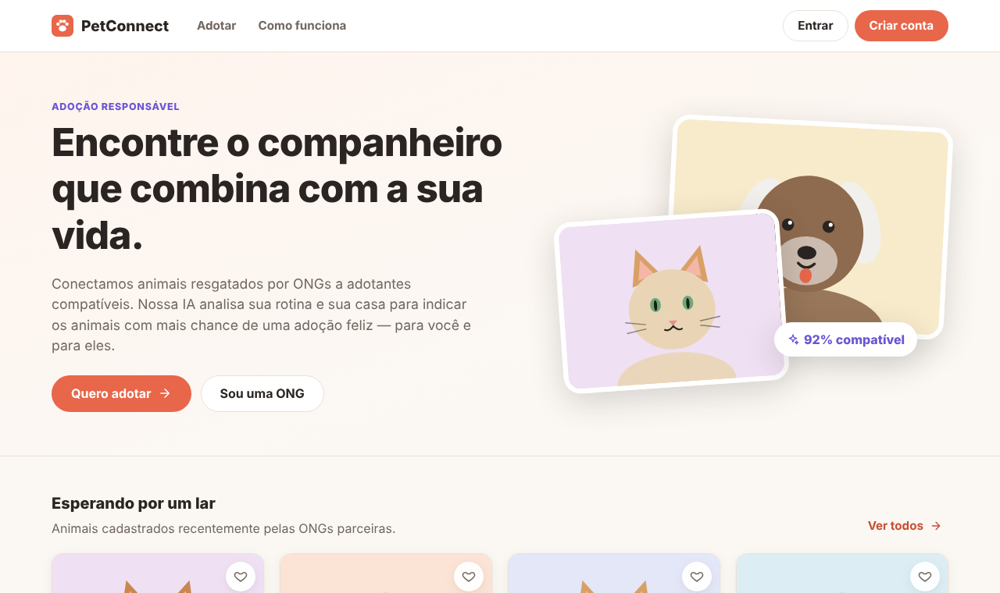

## 2. Quem usa o sistema

| Perfil | Quem é | O que pode fazer |
|---|---|---|
| **Visitante** | qualquer pessoa, sem login | ver o catálogo, filtrar animais, ver detalhes e criar conta |
| **Adotante** | pessoa que quer adotar | preencher o formulário, ver recomendações e compatibilidade, favoritar, comparar, pedir adoção e acompanhar o pedido |
| **ONG** | membro de uma instituição de proteção animal | cadastrar animais (com sugestão pela foto), analisar, aprovar, recusar e concluir adoções, registrar o pós-adoção e ver relatórios |
| **Administrador** | equipe que mantém a plataforma | aprovar ONGs, gerenciar contas e animais, ver dashboard, relatórios, pesquisa geral, histórico de operações e permissões |

Cada perfil só vê as telas e os botões que pode usar. Se alguém tentar abrir uma tela de outro perfil, o sistema mostra o aviso de **acesso restrito** (seção 8).

## 3. Acesso e autenticação

O sistema é acessado pelo navegador (Chrome, Edge ou Firefox), no computador ou no celular. O endereço é informado pela equipe; no ambiente de apresentação é **http://localhost:5173**.

### 3.1 Criar conta

1. Clique em **Criar conta**, no canto superior direito.
2. Escolha **Quero adotar** ou **Sou ONG / protetor**.
3. Preencha os campos. Para ONG também são pedidos nome da ONG, **CNPJ** e nome do responsável.
4. Marque o aceite dos termos e clique em **Criar conta**.

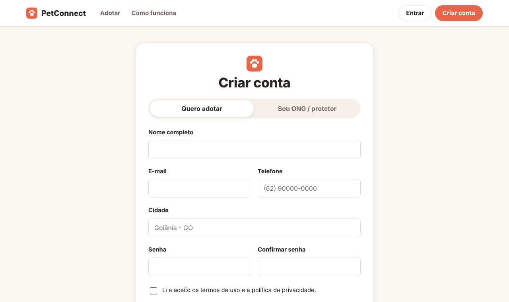

Se algum campo estiver vazio ou errado, a mensagem aparece em vermelho embaixo dele e a conta não é criada até ser corrigido:

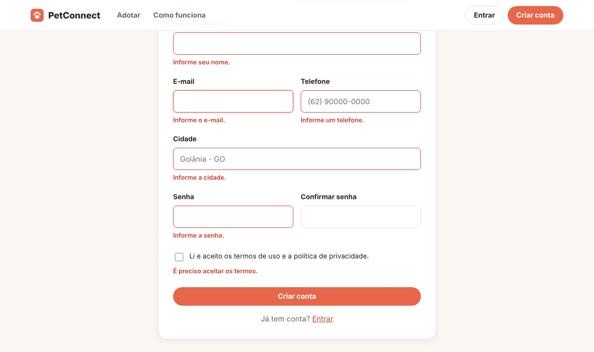

> **ONG:** a conta nasce com a situação **Aguardando aprovação**. A ONG já consegue entrar e ver o painel, mas só publica animais e decide pedidos depois que o administrador aprovar.

### 3.2 Entrar

1. Clique em **Entrar**.
2. Informe e-mail e senha e clique em **Entrar**.
3. Cada perfil cai na própria página inicial: **Minha área** (adotante), **Painel** (ONG) ou **Dashboard** (administrador).

Com e-mail ou senha errados aparece **"E-mail ou senha inválidos."**:

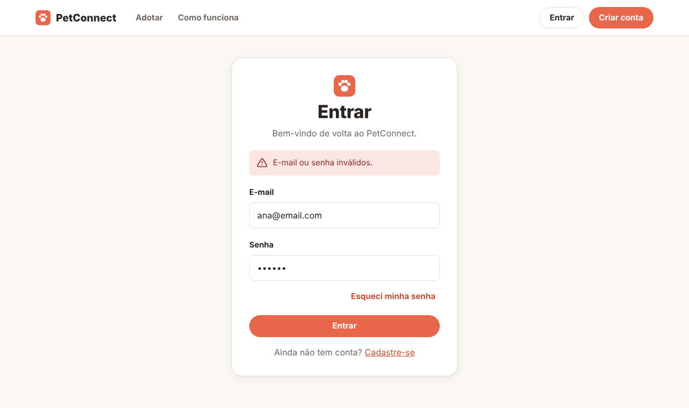

### 3.3 Esqueci a senha

1. Na tela de login, clique em **Esqueci minha senha**.
2. Informe o e-mail da conta e clique em **Enviar link**.
3. Abra o link recebido: ele leva à tela **Nova senha**, onde você cadastra a nova senha. O link vale por 1 hora.

> No ambiente local da apresentação não há envio de e-mail: o link aparece no terminal da API.

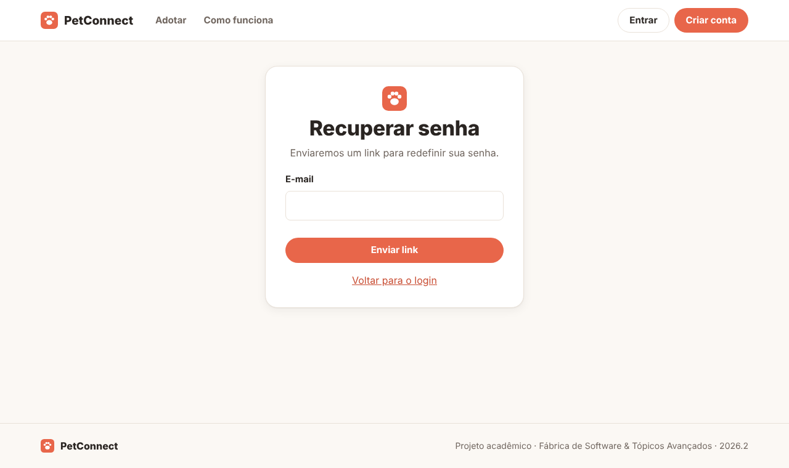

### 3.4 Sair e sessão

Para sair, clique no seu avatar (canto superior direito) e em **Sair**. Por segurança, a sessão expira depois de um tempo sem uso; o sistema avisa "Sua sessão expirou" e pede o login de novo, voltando para a página onde você estava.

### 3.5 Contas de demonstração

Na apresentação são usadas estas contas (senha **123456** em todas):

| Perfil | E-mail |
|---|---|
| Administrador | admin@adotapet.com |
| ONG aprovada | ong@patinhas.org |
| ONG aguardando aprovação | amigos4patas@email.com |
| Adotante | ana@email.com |

## 4. Visitante: conhecer os animais

### 4.1 Catálogo e filtros

Em **Adotar** aparecem todos os animais disponíveis das ONGs aprovadas.

- **Filtros** à esquerda: espécie, porte, idade e sexo. Podem ser combinados.
- **Busca**: digite nome, raça ou característica.
- **Ordenação**: mais recentes, por nome ou (para o adotante logado) por compatibilidade.
- O **coração** em cada cartão salva o animal nos favoritos (pede login).

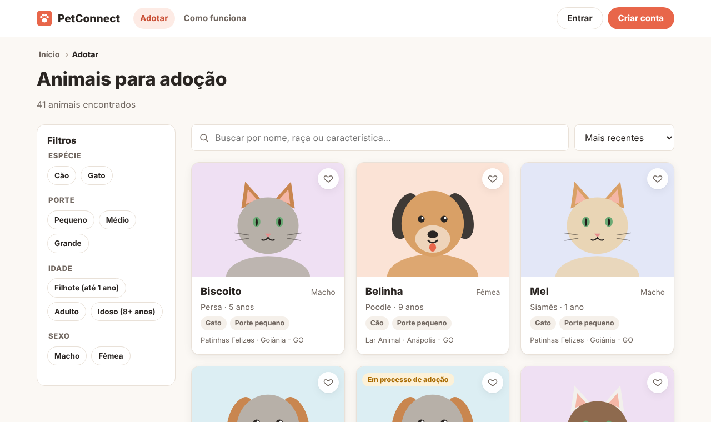

### 4.2 Detalhe do animal

Clique no cartão para ver fotos, idade, porte, energia, se convive com crianças e outros animais, se é castrado e vacinado, a descrição e a ONG responsável. O visitante vê o convite para criar conta e pedir a adoção.

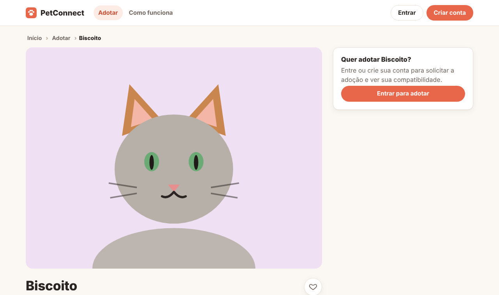

## 5. Adotante

### 5.1 Minha área

É a página inicial do adotante. Mostra:

- a **jornada de adoção** em cinco passos (criar conta → preencher formulário → escolher animal → solicitar → adoção concluída), com o próximo passo destacado;
- os números de favoritos, pedidos em andamento e aprovados;
- os animais **mais compatíveis** e as últimas solicitações.

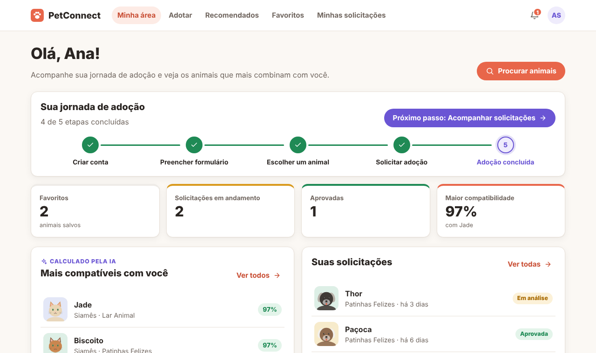

### 5.2 Formulário de avaliação (obrigatório para adotar)

O formulário pergunta sobre moradia (casa ou apartamento, quintal, telas de proteção), quem mora com você (crianças, outros animais), tempo que o animal ficará sozinho, experiência com animais e nível de atividade da família.

1. Abra **Minha área → Preencher formulário** (ou o menu do avatar → **Formulário de avaliação**).
2. Responda todas as perguntas e clique em **Salvar formulário**.
3. A partir daí, todos os animais passam a mostrar a sua compatibilidade.

Você pode atualizar as respostas a qualquer momento; os índices são recalculados.

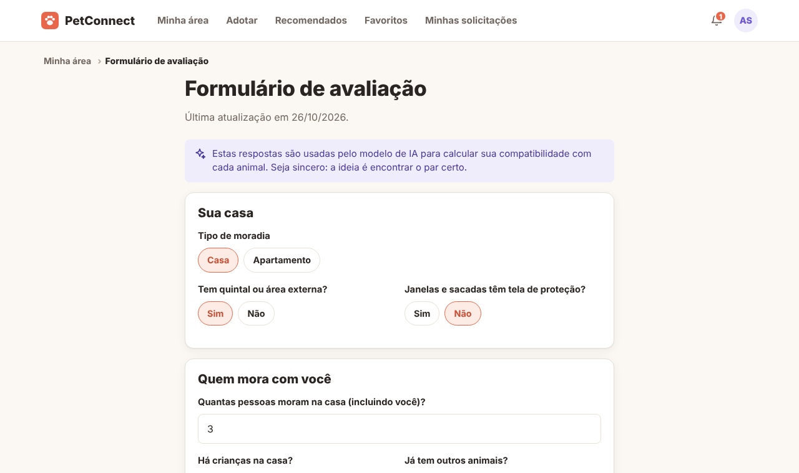

### 5.3 Recomendados para você

Em **Recomendados** o sistema compara o seu perfil com **todos** os animais disponíveis de uma vez e mostra os mais compatíveis primeiro, com o percentual e os dois principais motivos. Dá para filtrar por espécie, porte e faixa de compatibilidade.

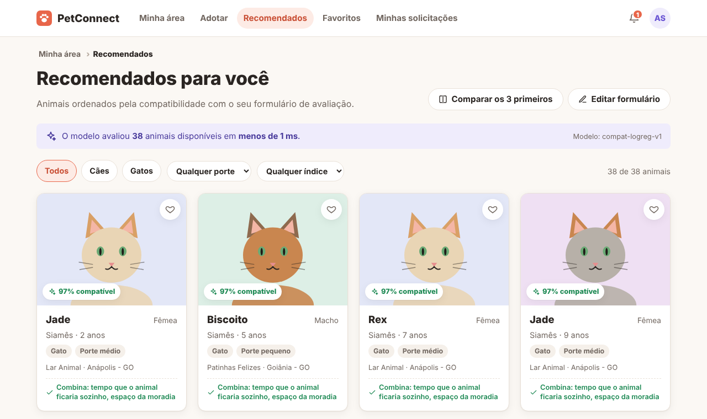

### 5.4 Compatibilidade no detalhe do animal

No detalhe de qualquer animal aparece o quadro **Sua compatibilidade**, com o percentual e a nota de cada fator:

| Fator | O que compara |
|---|---|
| Espaço da moradia | porte do animal × tipo de casa, quintal e telas |
| Nível de energia | energia do animal × estilo de vida da família |
| Tempo sozinho | horas fora de casa × tolerância do animal |
| Convivência com crianças | se há crianças × se o animal convive bem |
| Convivência com outros animais | se há outros animais × se o animal convive bem |
| Experiência do adotante | experiência × exigência do animal (filhote, muita energia, porte grande) |

O índice é uma **ajuda à decisão**: quem decide a adoção é sempre a ONG.

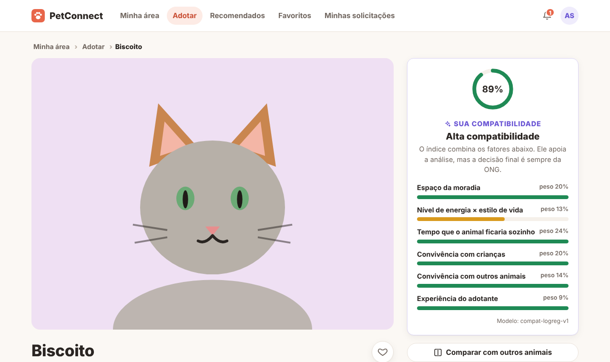

### 5.5 Solicitar adoção

1. No detalhe do animal, clique em **Solicitar adoção**.
2. Escreva uma mensagem para a ONG (opcional) e clique em **Enviar solicitação**.
3. O pedido aparece em **Minhas solicitações** com a situação **Pendente**.

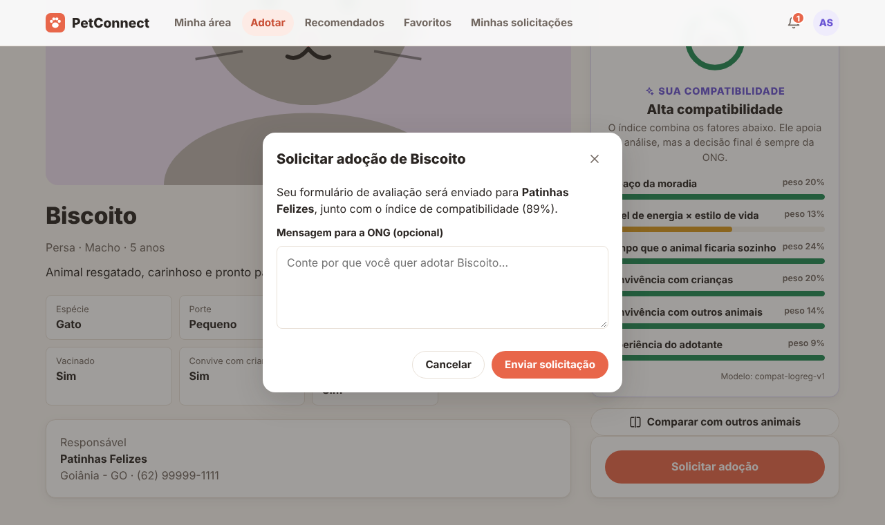

Regras que o sistema aplica:

- só pede adoção quem preencheu o formulário (o botão fica desabilitado e explica o motivo);
- não é possível ter dois pedidos ativos para o mesmo animal;
- animais adotados ou em processo de adoção não recebem pedidos.

### 5.6 Comparar animais

Em **Comparar compatibilidade** escolha até três animais para ver lado a lado o índice e cada fator. Ajuda a decidir entre animais parecidos.

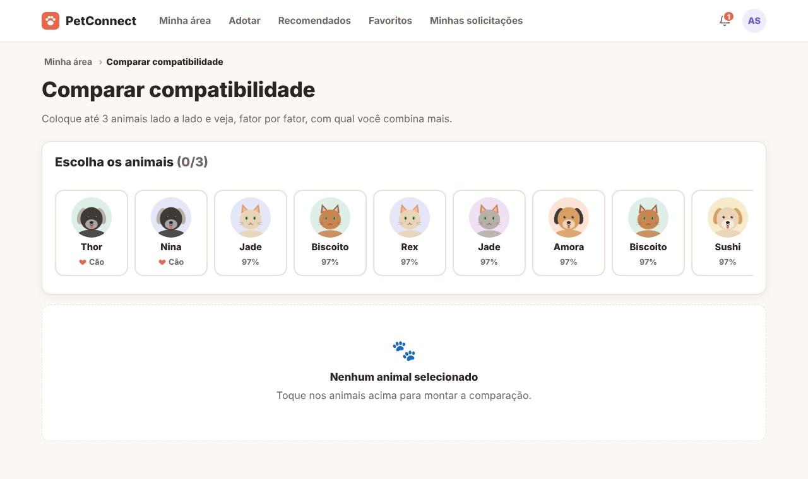

### 5.7 Favoritos

Clique no coração de um animal para guardá-lo. A lista fica em **Favoritos**, de onde é possível abrir o animal ou levá-lo para a comparação.

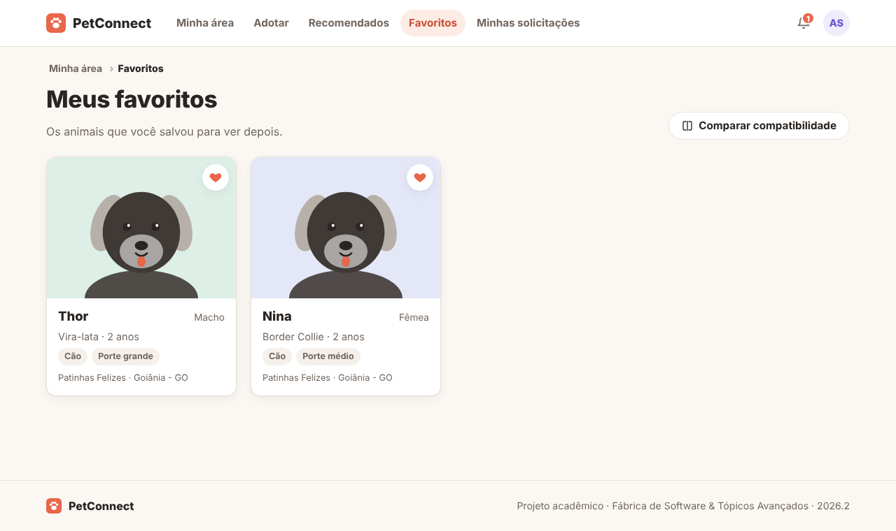

### 5.8 Acompanhar os pedidos

Em **Minhas solicitações** cada pedido mostra a **linha do tempo**: Pendente → Em análise → Aprovada → Adoção concluída (ou Recusada, com o motivo informado pela ONG). Enquanto o pedido estiver pendente ou em análise, é possível **cancelar**.

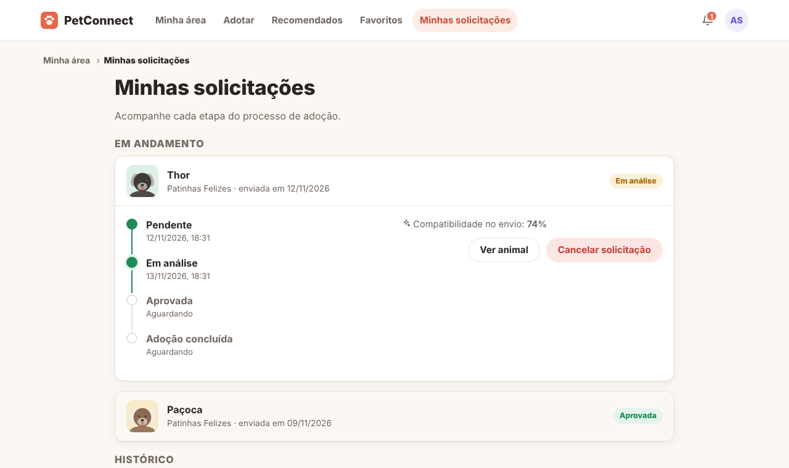

### 5.9 Notificações

O sino no topo mostra um número quando há novidades: pedido em análise, aprovado, recusado ou adoção concluída. Clique no sino para ver a lista; ao abrir, as notificações são marcadas como lidas.

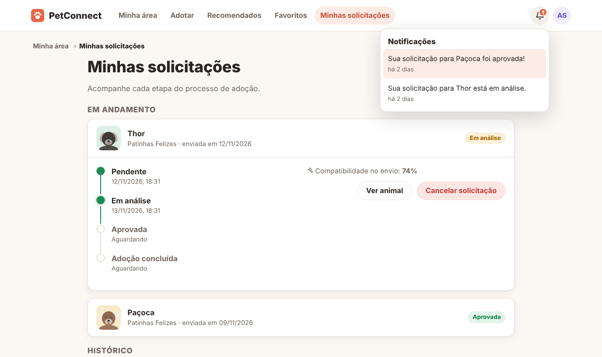

### 5.10 Meu perfil

Em **Meu perfil** (menu do avatar) você altera nome, telefone, cidade e senha. O quadro "O que você pode fazer" resume as permissões do seu perfil.

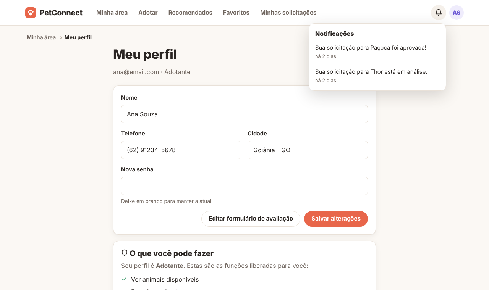

## 6. ONG

### 6.1 Painel da ONG

Mostra os animais disponíveis, em processo e adotados, as solicitações abertas e o desempenho da ONG no período (pedidos recebidos, adoções concluídas, taxa de aprovação e tempo médio até a adoção). Se a ONG ainda não foi aprovada, o painel mostra o aviso **Aguardando aprovação**.

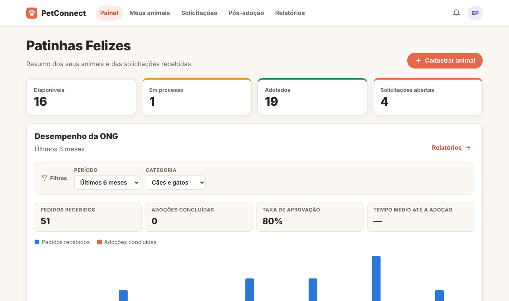

### 6.2 Meus animais

Lista os animais da ONG com abas por situação (Todos, Disponível, Em processo, Adotado), busca e ações de **editar**, **ver** e **remover**.

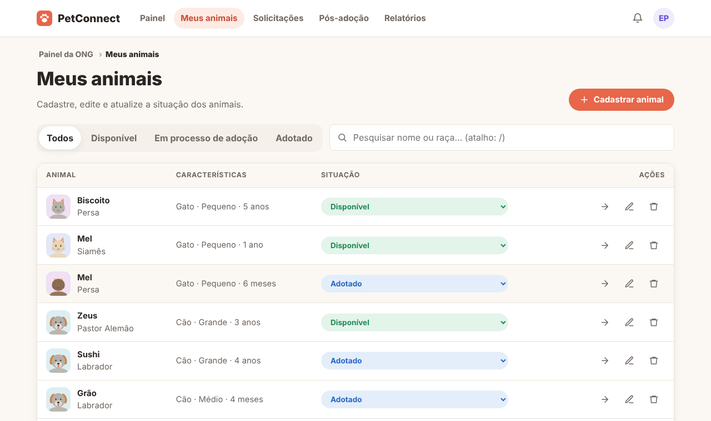

### 6.3 Cadastrar um animal com a sugestão pela foto

1. Em **Meus animais**, clique em **Cadastrar animal**.
2. Em **Fotos**, clique em **Adicionar fotos** e escolha de 1 a 6 imagens (JPG, PNG ou WEBP, até 5 MB cada). A primeira é a capa.
3. Ao enviar a primeira foto, o sistema analisa a imagem e mostra o quadro **"A IA sugere a partir da foto"**, com espécie, raça provável e porte, cada um com o percentual de confiança.
4. Clique em **Aplicar sugestão** para preencher esses campos, ou em **Ignorar** para preencher à mão. Confira sempre: a sugestão pode errar, principalmente em animais sem raça definida (SRD).
5. Complete nome, idade, sexo, energia, convivência, castração, vacinação e descrição.
6. Clique em **Publicar animal**. Ele aparece na hora no catálogo público.

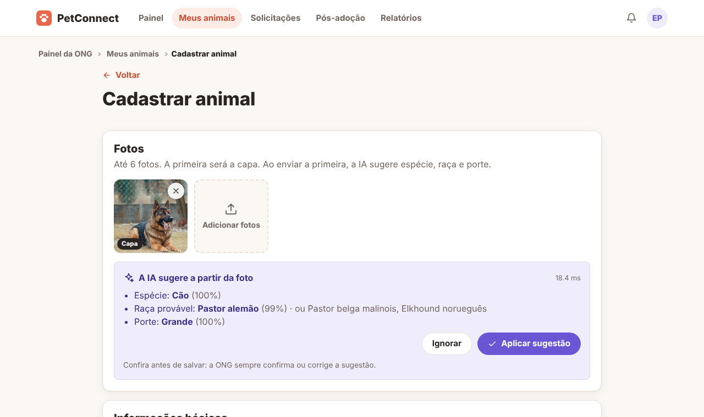

Campos obrigatórios em branco ficam marcados em vermelho e o animal não é salvo:

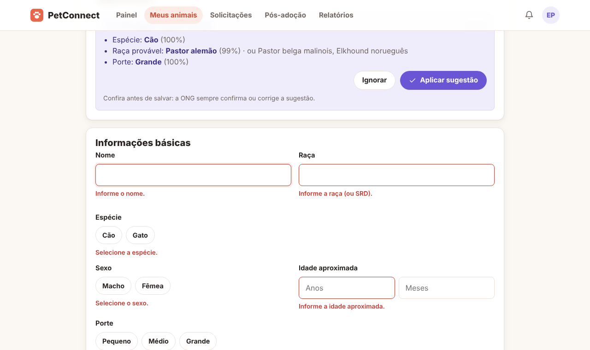

> Se a foto não mostrar um cão ou um gato, o sistema avisa "Não identificamos um cão ou gato nesta foto. Preencha os campos manualmente." e o cadastro continua normalmente.

**Editar e remover:** em **Meus animais**, use o lápis para editar e a lixeira para remover. Um animal com pedido em andamento não pode ser removido (o sistema explica o motivo). A situação **Adotado** só é aplicada pela conclusão da adoção, nunca à mão.

### 6.4 Analisar solicitações

Em **Solicitações** ficam os pedidos recebidos, com abas (Abertas, Aprovadas, Concluídas, Recusadas/encerradas, Todas), busca e ordenação por **maior compatibilidade**.

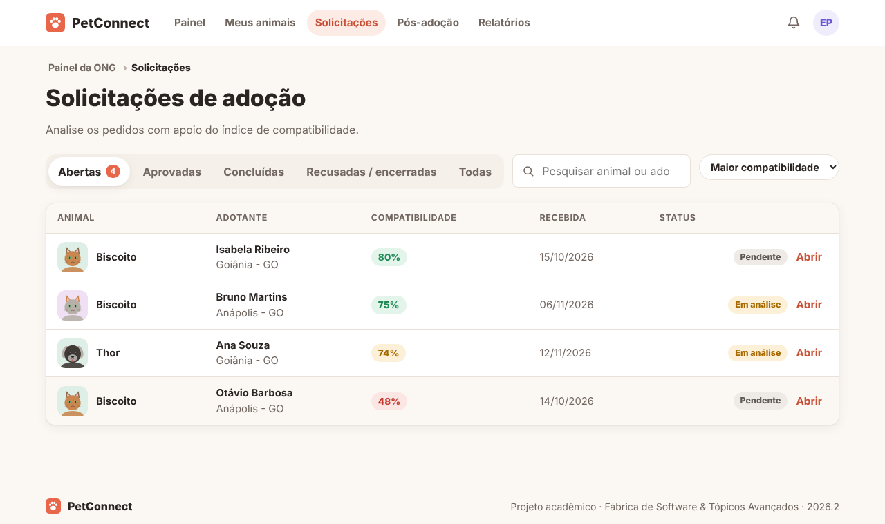

Ao abrir um pedido, a ONG vê:

- o **índice de compatibilidade** calculado pela IA, com cada fator explicado;
- as respostas do formulário do adotante e os dados de contato;
- a linha do tempo do pedido.

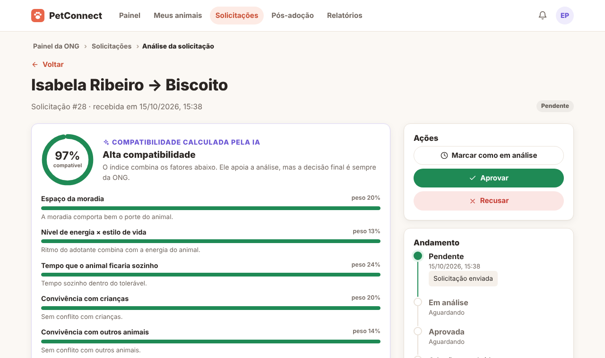

Passo a passo da decisão:

1. **Marcar como em análise**: avisa o adotante que o pedido está sendo avaliado.
2. **Aprovar**: o animal passa para **Em processo de adoção** e os outros pedidos para o mesmo animal são encerrados automaticamente.
   **Recusar**: é obrigatório escrever o motivo, que o adotante vê.
3. Depois da entrega do animal, **Concluir adoção**: o animal passa para **Adotado**.

Cada mudança notifica o adotante e fica registrada no histórico.

### 6.5 Pós-adoção

Em **Pós-adoção** aparecem as adoções concluídas. Clique em **Registrar** para anotar uma visita, ligação ou mensagem, com a data e as observações (a data não pode ser futura).

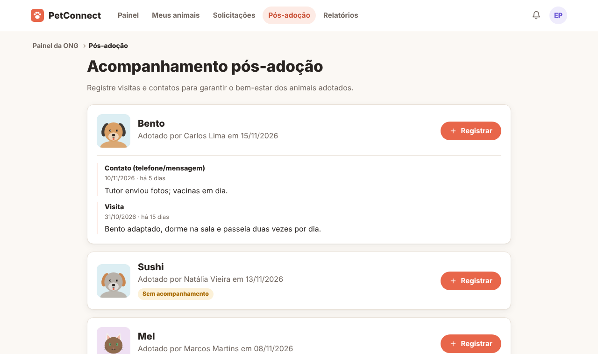

### 6.6 Relatórios da ONG

Em **Relatórios** há três relatórios (solicitações recebidas, adoções e pós-adoção, animais à espera), com filtros de período, categoria e situação, totais no topo e exportação em **CSV** (abre no Excel) e **PDF**.

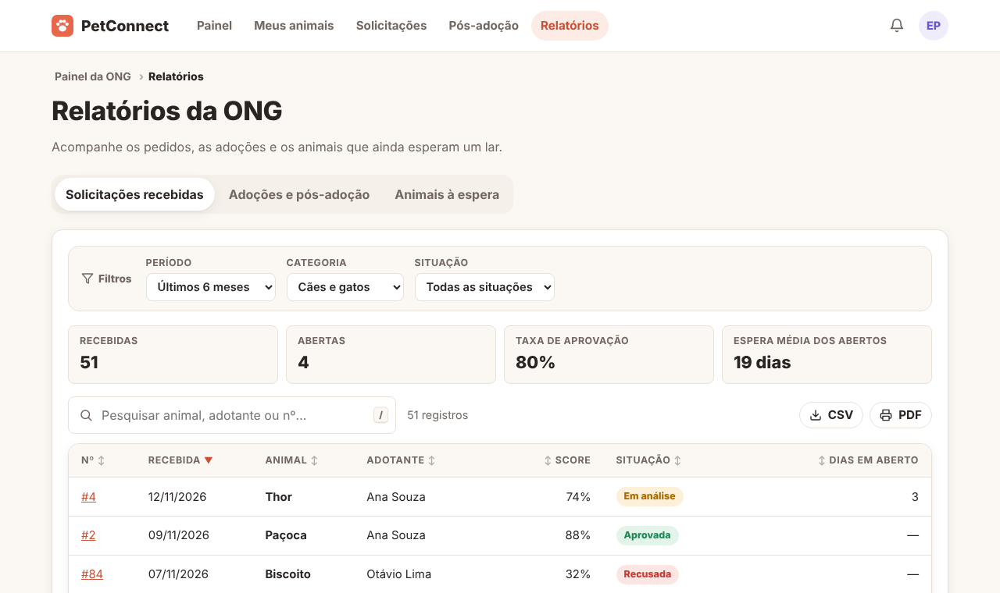

## 7. Administrador

### 7.1 Dashboard

Visão geral da plataforma: ONGs aguardando aprovação, animais disponíveis e adotados, solicitações abertas, taxa de aprovação, gráfico mensal de solicitações e adoções, funil de adoção, desempenho por ONG e se a compatibilidade ajudou (taxa de aprovação por faixa de compatibilidade). Os filtros de período, ONG e categoria valem para todos os quadros.

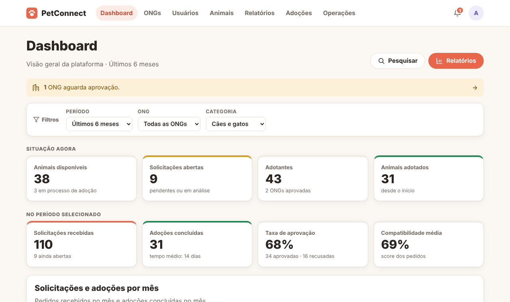

No fim do dashboard fica o quadro **Desempenho: sequencial × OpenCL**, que mostra quanto o cálculo em paralelo (OpenCL) é mais rápido que o cálculo um a um ao pontuar milhares de animais:

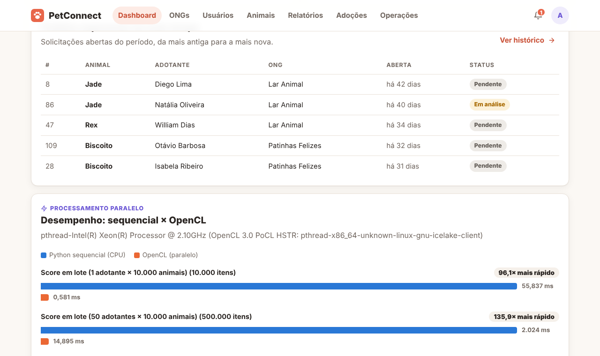

### 7.2 Aprovar ONGs

Em **ONGs**, a aba **Aguardando aprovação** lista as ONGs novas com CNPJ, responsável e contato. Use **Aprovar** ou **Recusar**. ONGs aprovadas podem ser **suspensas**; os animais de uma ONG suspensa saem do catálogo.

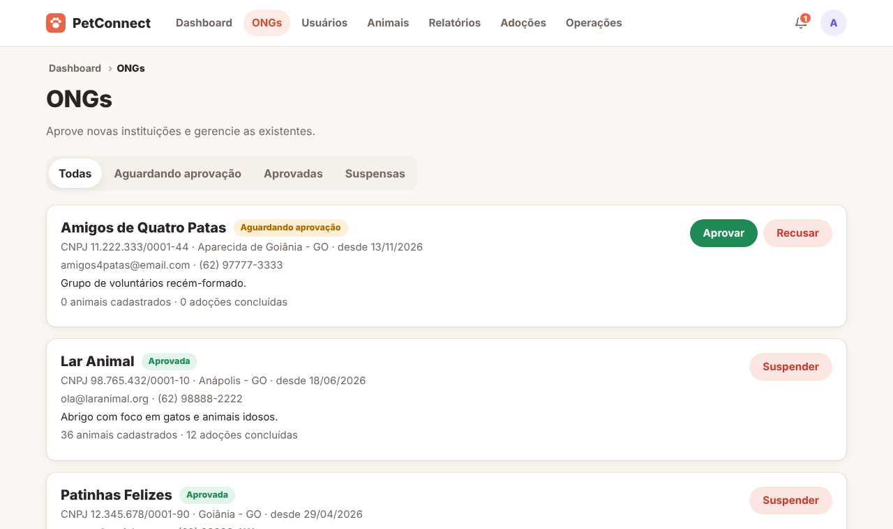

### 7.3 Usuários e animais

- **Usuários:** busca por nome ou e-mail, filtro por perfil, **Desativar** e **Reativar** contas. Uma conta desativada perde o acesso na hora, mesmo se estiver logada. O administrador não consegue desativar a própria conta.
- **Animais:** todos os animais de todas as ONGs, com filtros e exportação.

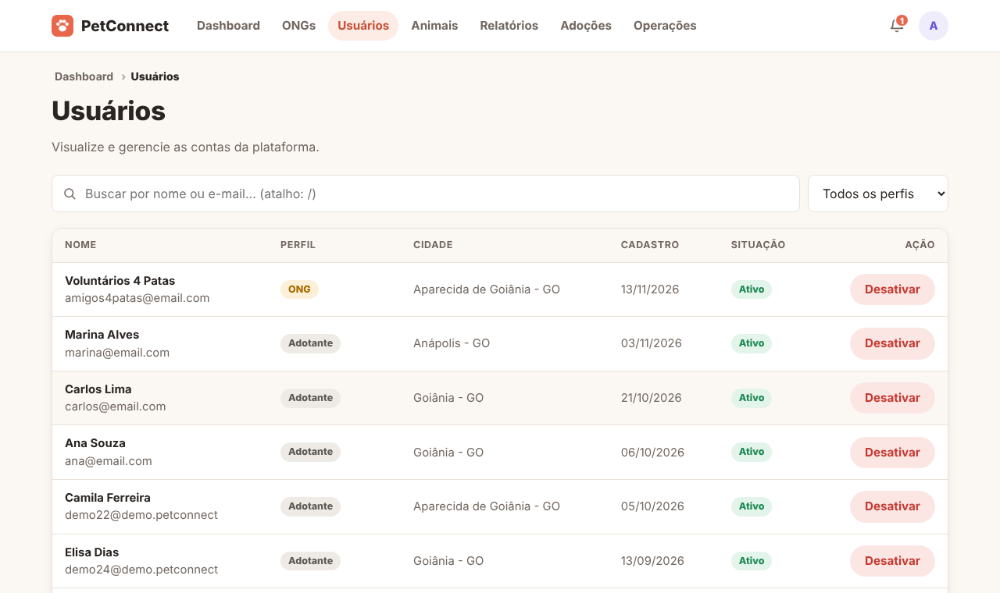

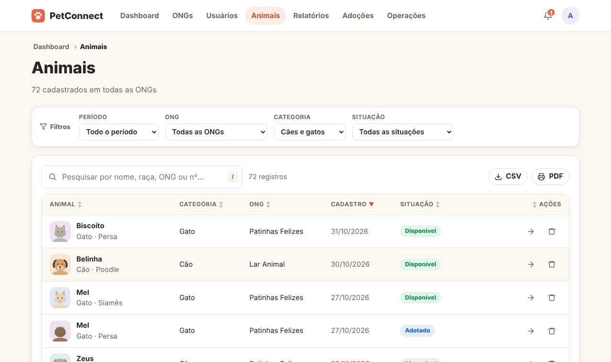

### 7.4 Relatórios

Seis relatórios: solicitações, adoções concluídas, desempenho por ONG, animais à espera, compatibilidade × resultado e cadastros na plataforma. Todos com filtros, totais e exportação em CSV e PDF.

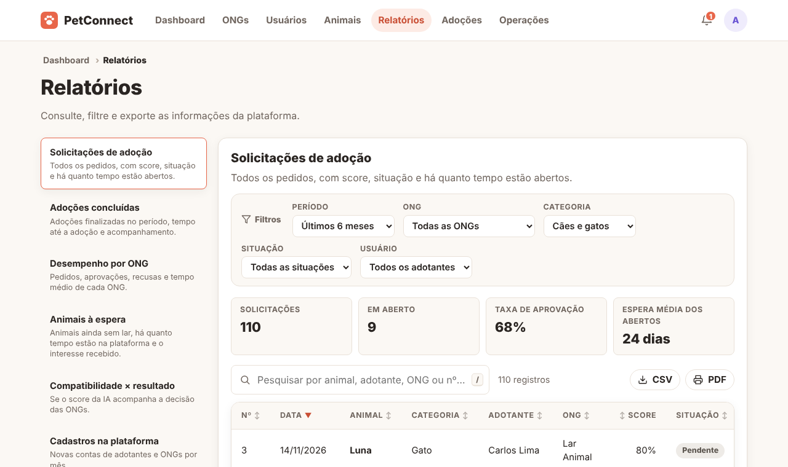

### 7.5 Pesquisa geral

Em **Pesquisar**, digite pelo menos 2 letras (nome de animal, pessoa, ONG ou número do pedido) para buscar em tudo ao mesmo tempo.

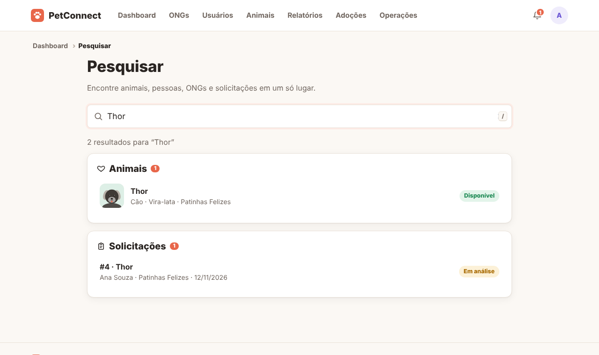

### 7.6 Histórico de operações e permissões

- **Histórico de operações:** quem fez o quê e quando (logins, cadastros, aprovações, alterações), com filtros e exportação. Os registros não podem ser alterados nem apagados.
- **Permissões:** tabela de quais funções cada perfil pode usar.

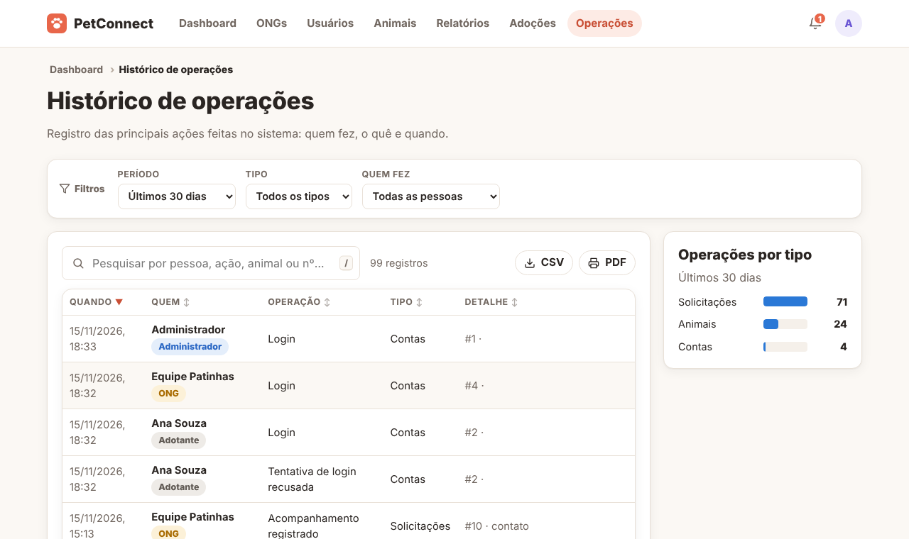

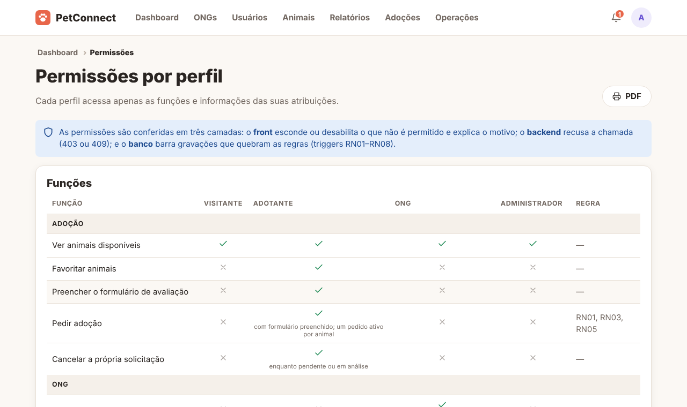

## 8. Mensagens, validações e situações comuns

### 8.1 Mensagens mais comuns

| Situação | Mensagem | O que fazer |
|---|---|---|
| E-mail ou senha errados | "E-mail ou senha inválidos." | confira os dados ou use "Esqueci minha senha" |
| Conta desativada | o login é recusado | fale com o administrador |
| E-mail já usado no cadastro | "Já existe um usuário cadastrado com este e-mail." | entre com esse e-mail ou use outro |
| CNPJ errado | "CNPJ inválido. Confira os 14 números (00.000.000/0000-00)." | digite o CNPJ correto |
| Senha curta | "A senha precisa ter pelo menos 6 caracteres." | use 6 ou mais caracteres |
| Pedir adoção sem formulário | botão desabilitado com o aviso para preencher o formulário | preencha o formulário de avaliação |
| Segundo pedido para o mesmo animal | "Você já tem uma solicitação ativa para este animal." | acompanhe o pedido existente |
| ONG não aprovada tenta cadastrar animal | "A ONG precisa estar aprovada e ativa para realizar esta operação." | aguarde a aprovação do administrador |
| Foto em formato errado ou grande | "Formato de imagem não permitido." / "A imagem deve possuir no máximo 5 MB." | use JPG, PNG ou WEBP com até 5 MB |
| Foto sem cão nem gato | "Não identificamos um cão ou gato nesta foto. Preencha os campos manualmente." | preencha espécie, raça e porte à mão |
| Recusar sem motivo | campo de motivo marcado como obrigatório | escreva o motivo da recusa |
| Pesquisa com 1 letra | "Digite pelo menos 2 letras" | digite mais letras |
| Sessão expirada | "Sua sessão expirou" | entre de novo |

### 8.2 Acesso restrito

Se um perfil tentar abrir uma página de outro (por exemplo, o adotante digitando o endereço do painel do administrador), aparece a tela abaixo com o botão para voltar à própria página inicial.

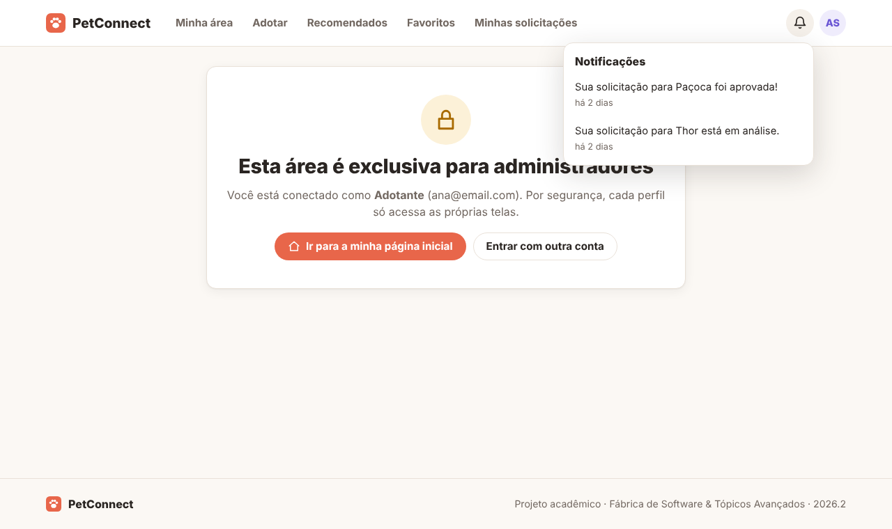

### 8.3 Página não encontrada

Endereços que não existem mostram a página abaixo, com atalhos para as páginas principais.

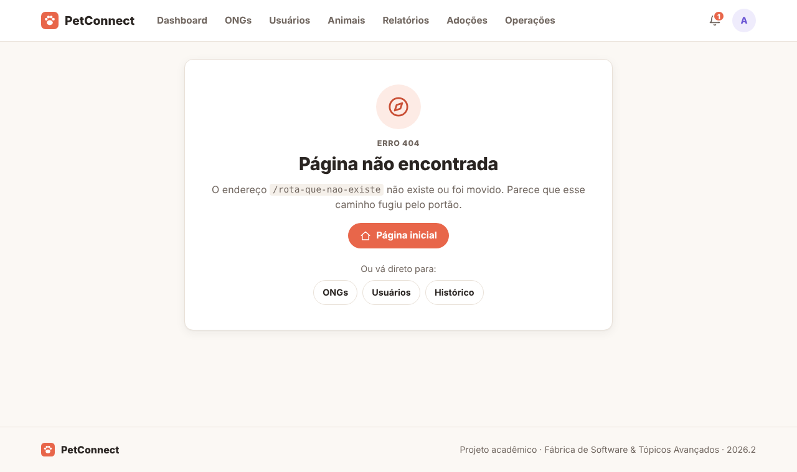

### 8.4 Confirmações

Ações que não podem ser desfeitas (remover animal, recusar pedido, desativar conta, cancelar pedido) pedem confirmação antes. Se você sair de um formulário com alterações não salvas, o sistema pergunta se quer mesmo sair.

### 8.5 Uso no celular

Todas as telas se ajustam ao celular. O menu fica no botão ☰ no topo; tabelas largas podem ser roladas para o lado.

## 9. Perguntas frequentes

**O índice de compatibilidade decide a adoção?**
Não. Ele mostra o quanto o perfil combina com o animal e explica os motivos; a decisão é sempre da ONG.

**Por que o animal que eu queria sumiu do catálogo?**
Ele foi aprovado para outra pessoa (em processo), adotado ou removido pela ONG.

**Posso pedir mais de um animal?**
Sim, um pedido ativo por animal.

**A sugestão pela foto acerta sempre?**
Não. Ela acerta bem a espécie e o porte e dá a raça provável; para animais sem raça definida costuma sugerir "SRD". A ONG sempre confere antes de salvar.

**Meus dados aparecem para quem?**
Seu nome, contato e respostas do formulário só aparecem para a ONG do animal que você pediu e para o administrador.
