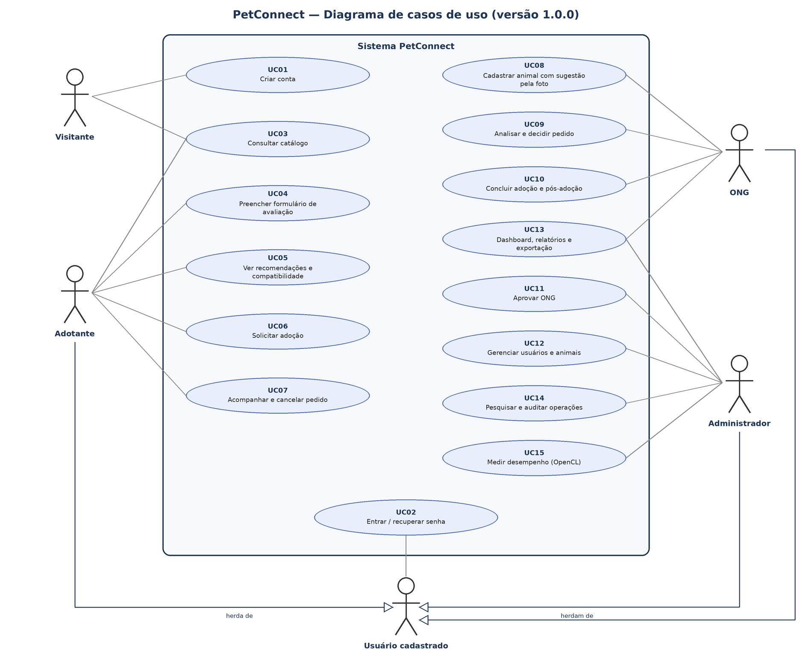

# PetConnect — Requisitos, regras de negócio e casos de uso (versão final)

**Versão 1.0.0** · revisado na Sprint 11 para refletir o que foi de fato implementado.

## 1. Requisitos funcionais

Todos os requisitos abaixo estão implementados e cobertos por testes automatizados (API: `backend/tests`, interface: `testes-e2e`).

| Código | Requisito | Perfil | Onde está | Sprint |
|---|---|---|---|---|
| RF01 | Cadastro de usuários (adotantes) | visitante | tela Criar conta · `POST /api/auth/cadastro/adotante` | 03–04 |
| RF02 | Login com credenciais e recuperação de senha | todos | Entrar / Esqueci minha senha · `/api/auth/*` | 03–04 |
| RF03 | Cadastro de ONGs (com CNPJ validado) | visitante | Criar conta → Sou ONG · `POST /api/auth/cadastro/ong` | 04, 09 |
| RF04 | Cadastro de animais pelas ONGs | ONG | Cadastrar animal · `POST /api/ong/animais` | 04 |
| RF05 | Cadastro de fotos dos animais (até 6, JPG/PNG/WEBP, 5 MB cada) | ONG | Cadastrar animal · `POST /api/uploads/fotos` | 04 |
| RF06 | Informações do animal (nome, espécie, raça, idade, sexo, porte, energia, convivência, saúde, descrição) | ONG | Cadastrar/editar animal | 04 |
| RF07 | Visualização dos animais disponíveis | todos | Adotar, Detalhe · `GET /api/animais` | 04 |
| RF08 | Busca e filtros (espécie, porte, idade, sexo, texto) | todos | Adotar | 04 |
| RF09 | Favoritos | adotante | coração, Favoritos · `/api/favoritos` | 04 |
| RF10 | Solicitação de adoção | adotante | Detalhe → Solicitar adoção · `POST /api/solicitacoes` | 05 |
| RF11 | Formulário de avaliação do adotante | adotante | Formulário de avaliação · `/api/formulario` | 05 |
| RF12 | Análise das solicitações pela ONG | ONG | Solicitações, Análise · `/api/ong/solicitacoes` | 05 |
| RF13 | Aprovação ou recusa da solicitação (recusa com motivo) | ONG | Análise da solicitação | 05 |
| RF14 | Acompanhamento do status pelo adotante (linha do tempo e notificações) | adotante | Minhas solicitações, sino | 05 |
| RF15 | Atualização do status do animal pelo fluxo de adoção | ONG | automático na aprovação/conclusão | 05, 08 |
| RF16 | Histórico de solicitações, adoções e acompanhamento pós-adoção | ONG, admin | Pós-adoção, Histórico | 05, 07 |
| RF17 | Gerenciamento de usuários (desativar/reativar) | admin | Usuários | 06–08 |
| RF18 | Gerenciamento de ONGs (aprovar, recusar, suspender) | admin | ONGs | 06 |
| RF19 | Gerenciamento de animais | admin | Animais | 06 |
| RF20 | Cálculo de compatibilidade adotante × animal (IA) | adotante, ONG | Detalhe, Análise · `GET /api/ia/compatibilidade/{id}` | 06 |
| RF21 | Apoio à análise da ONG com o índice e seus fatores | ONG | Análise da solicitação | 06 |
| RF22 | Recomendação de animais por compatibilidade (cálculo em lote com OpenCL) | adotante | Recomendados, Comparar · `GET /api/ia/recomendacoes` | 06 |
| RF23 | Sugestão de espécie, raça e porte a partir da foto | ONG | Cadastrar animal · `POST /api/ia/classificar-imagem` | **11** |
| RF24 | Dashboard e relatórios com filtros e exportação CSV/PDF | ONG, admin | Painel, Dashboard, Relatórios | 07 |
| RF25 | Pesquisa geral e histórico de operações (logs) | admin | Pesquisar, Histórico de operações | 07–08 |
| RF26 | Controle de permissões por perfil | todos | rotas protegidas, Permissões | 08 |

RF20 a RF23 cobrem o componente computacional avançado (Tópicos Avançados). RF24 a RF26 foram formalizados nas Sprints 07 e 08. O RF23 estava preparado no front desde a Sprint 06 e foi concluído no back na Sprint 11.

## 2. Requisitos não funcionais

| Código | Requisito | Como foi atendido |
|---|---|---|
| RNF01 | Interface responsiva (computador e celular) | 22 telas conferidas em 1280 px e 390 px (Sprint 10) |
| RNF02 | Segurança de senha e sessão | bcrypt, JWT, conta conferida a cada requisição |
| RNF03 | Controle de acesso por perfil no front e no back | rotas protegidas + conferência de perfil e dono em cada rota |
| RNF04 | Integridade dos dados | chaves estrangeiras, `CHECK`, índices únicos e triggers |
| RNF05 | Auditoria | `log_acao` imutável com quem, quando e o quê |
| RNF06 | Desempenho do cálculo em lote | OpenCL/NumPy: 10.000 animais em menos de 2 ms por adotante |
| RNF07 | Mensagens claras em português | validações no front e `detail` em português na API |
| RNF08 | Documentação da API | Swagger em português, `docs/API.md`, `docs/openapi.json` |
| RNF09 | Testabilidade | 106 testes da API e 25 da interface, com relatório |
| RNF10 | Credenciais fora do código | `.env` fora do Git; só `.env.example` |

## 3. Regras de negócio (numeração final)

Durante as Sprints 05 e 08 algumas regras ganharam números diferentes em documentos diferentes. A tabela abaixo é a numeração **oficial** da versão 1.0.0.

| Código | Regra | Onde é garantida |
|---|---|---|
| RN01 | Só recebe pedido de adoção o animal disponível, não excluído, de ONG aprovada | API + front |
| RN02 | Ao aprovar um pedido, o animal passa a "em processo" e os outros pedidos para ele são encerrados; nunca há dois aprovados para o mesmo animal | API (bloqueio) + banco (índice único `vencedora`) |
| RN03 | Só pede adoção quem preencheu o formulário de avaliação | API + front (botão desabilitado) |
| RN04 | ONG só publica animais e decide pedidos depois de aprovada; pendente ou suspensa apenas consulta | API + front + trigger |
| RN05 | Um usuário não pode ter dois pedidos ativos para o mesmo animal | API + banco (índice único `ativa`) |
| RN06 | Recusa exige motivo, que o adotante vê | API + banco (`CHECK`) |
| RN07 | "Em processo" e "adotado" só mudam pelo fluxo de adoção; concluir marca o animal como adotado; só adoções concluídas recebem acompanhamento | API + front + trigger (máquina de estados) |
| RN08 | Animal com pedido em andamento não pode ser excluído | API + trigger |
| RN09 | Cada mudança de status gera registro no histórico; análise, aprovação, recusa e conclusão notificam o adotante | API |
| RN10 | O histórico de operações não pode ser alterado nem apagado | banco (triggers em `log_acao`) |
| RN11 | O administrador não desativa a própria conta nem o último administrador ativo | API |
| RN12 | Conta desativada perde o acesso imediatamente | API (`security.py`) |
| RN13 | Data do acompanhamento não pode ser futura; idade do animal até 25 anos | API + front |
| RN14 | A sugestão da IA pela foto nunca é aplicada sozinha: a ONG confirma ou corrige | front + registro em `classificacao_imagem.aceita` |

## 4. Casos de uso

| UC | Caso de uso | Ator | Pré-condição | Fluxo principal | Fluxos alternativos |
|---|---|---|---|---|---|
| UC01 | Criar conta | Visitante | — | escolhe o tipo, preenche, aceita termos, conta criada (ONG fica pendente) | e-mail já usado; CNPJ inválido; campos vazios |
| UC02 | Entrar / recuperar senha | Todos | conta ativa | informa e-mail e senha, vai para a página inicial do perfil | senha errada; conta desativada; pede link de nova senha |
| UC03 | Consultar catálogo | Todos | — | filtra, busca, abre o detalhe | nenhum animal com o filtro |
| UC04 | Preencher formulário de avaliação | Adotante | logado | responde e salva; compatibilidades passam a aparecer | respostas faltando |
| UC05 | Ver recomendações e compatibilidade | Adotante | formulário preenchido | sistema calcula em lote e ordena; mostra fatores | sem formulário → convite para preencher |
| UC06 | Solicitar adoção | Adotante | formulário preenchido | escreve mensagem e envia; pedido pendente | animal indisponível; pedido duplicado |
| UC07 | Acompanhar e cancelar pedido | Adotante | pedido criado | vê linha do tempo e notificações; pode cancelar enquanto pendente/em análise | — |
| UC08 | Cadastrar animal com sugestão pela foto | ONG | ONG aprovada | envia foto, IA sugere espécie/raça/porte, ONG aplica ou ignora, completa e publica | foto sem cão/gato; ONG pendente bloqueada |
| UC09 | Analisar e decidir pedido | ONG | pedido recebido | vê índice e fatores, marca em análise, aprova ou recusa com motivo | outro pedido já aprovado |
| UC10 | Concluir adoção e registrar pós-adoção | ONG | pedido aprovado | conclui (animal adotado) e registra visitas | data futura recusada |
| UC11 | Aprovar ONG | Admin | ONG pendente | aprova, recusa ou suspende | — |
| UC12 | Gerenciar usuários e animais | Admin | — | busca, desativa/reativa, consulta animais | tentar desativar a si mesmo |
| UC13 | Consultar dashboard, relatórios e exportar | ONG, Admin | — | filtra período/ONG/categoria, exporta CSV/PDF | período sem dados |
| UC14 | Pesquisar e auditar operações | Admin | — | pesquisa geral, histórico de operações com filtros | busca com 1 letra |
| UC15 | Medir desempenho do cálculo paralelo | Admin (técnico) | — | roda o benchmark; dashboard mostra sequencial × OpenCL | sem OpenCL → NumPy |

## 5. Rastreabilidade com os testes

| Área | Requisitos/regras | Testes da API | Testes da interface |
|---|---|---|---|
| Autenticação e cadastros | RF01–RF03, RN12 | CT-01 a CT-20 | NV-01, VL-01 a VL-04 |
| Animais | RF04–RF08, RN08, RN13 | CT-21 a CT-33 | VL-05, VL-06, FX-01 |
| Adotante e IA | RF09, RF11, RF20–RF22, RN03 | CT-34 a CT-40 | NV-03, VL-07 |
| Solicitações | RF10, RF12–RF16, RN01, RN02, RN05–RN09 | CT-41 a CT-59 | FX-02, FX-03 |
| Administração | RF17–RF19, RF24–RF25, RN10, RN11 | CT-60 a CT-71 | VL-08, FX-04 |
| Consultas e permissões | RF26, RN04 | CT-72 a CT-79 | NV-04 a NV-13 |
| Sugestão pela foto e fotos | RF05, RF23, RN14 | CT-80 a CT-88 | FX-01 |

Relatórios completos: `backend/tests/RELATORIO.md` e `docs/sprints/sprint12/RELATORIO_INTERFACE.md`.
